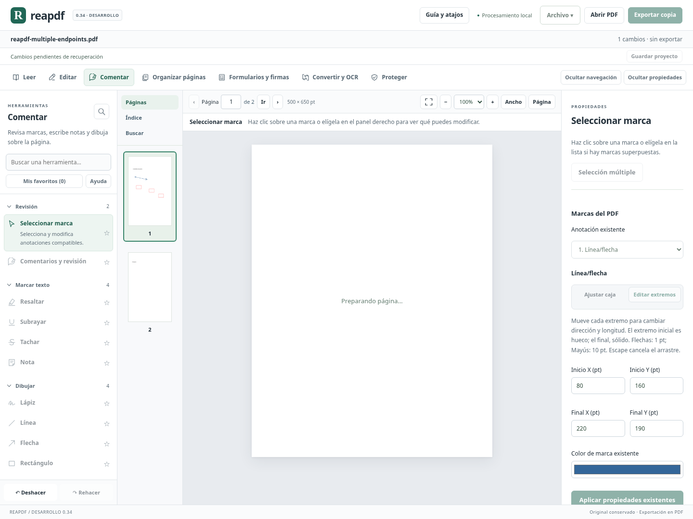
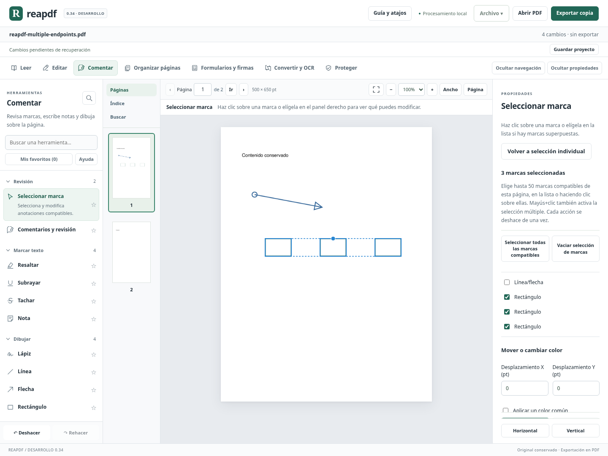
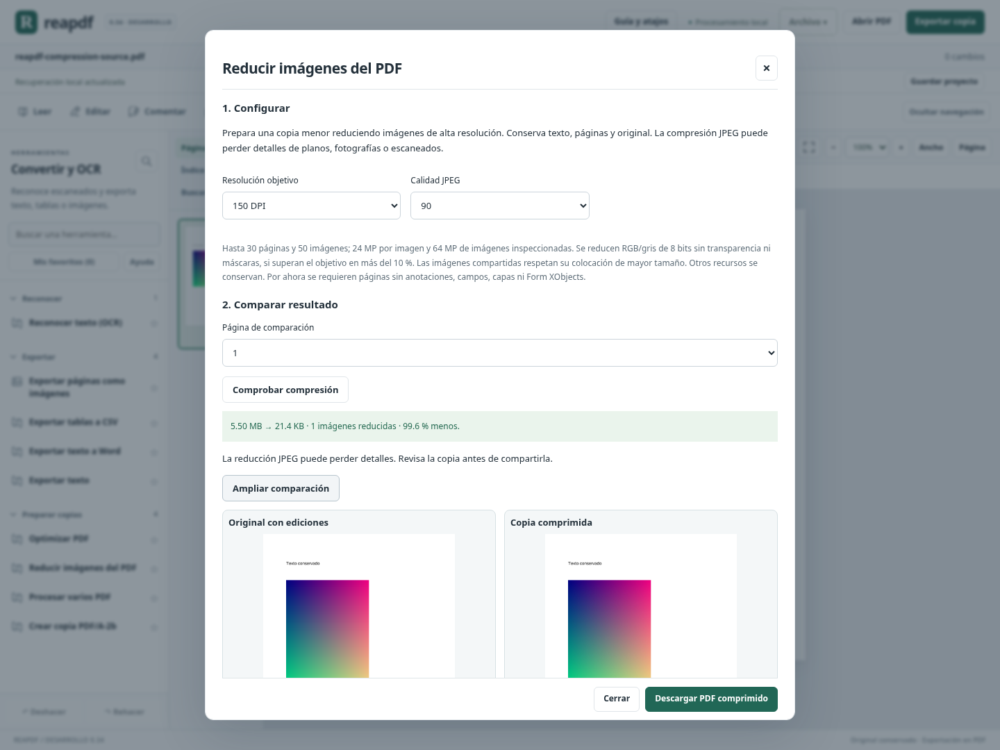

# Avance 0.34: extremos, selección múltiple y evidencia de cierre

## Extremos independientes de líneas y flechas

En **Comentar → Seleccionar marca**, una línea/flecha existente compatible permite alternar entre **Ajustar caja** y **Editar extremos**. El segundo modo añade dos tiradores: inicial hueco y final sólido. Cada uno cambia su posición sin obligar a mover el otro; también hay cuatro campos Inicio X/Y y Final X/Y.

Esto permite cambiar la orientación de una línea originalmente horizontal o vertical, invertirla y ajustar su longitud. Flechas de teclado: 1 pt; Mayús+flecha: 10 pt; Escape/cancelación del puntero: descartar el arrastre. La guía azul anticipa la línea central propuesta. El borde real y los símbolos de los extremos se comprueban al aplicar.

La longitud mínima es 1 pt. El motor conserva el orden de los extremos y los tipos PDF de punta, además de grosor, guiones, opacidad, autor, identidad y texto ajeno. Las cuatro rotaciones y el recorte de página se contemplan. Los cambios de caja posteriores a una edición de extremos se aplican a la dirección actual; no vuelven a la orientación del original.

Antes de regenerar una apariencia se comprueba su fidelidad, como en 0.33. La protección ahora cubre también recolorear trazos/líneas: si su apariencia personalizada no puede reproducirse, se rechaza la operación para no perder símbolos. Un traslado compatible puede seguir conservando la apariencia original sin regenerarla. Firmas, restricciones, bloqueos, grupos, capas, mediciones y acciones especiales mantienen sus protecciones.



## Seleccionar varias marcas del PDF

En **Seleccionar marca → Selección múltiple**, elige hasta 50 marcas existentes compatibles de la página actual. La lista permite marcar/desmarcar y vaciar la selección. Mayús/Ctrl/⌘+clic sobre una marca también activa o amplía la selección; el orden de elección determina cuál es la primera marca.

Capacidades nuevas:

- Mover todo el conjunto con el tirador, teclado o desplazamientos X/Y.
- Alinear a izquierda, centro horizontal, derecha, arriba, centro vertical o abajo.
- Usar como referencia los límites del conjunto o la primera marca elegida.
- Distribuir horizontal o verticalmente igualando los espacios entre límites, sin cambiar tamaños. Se necesitan tres marcas y espacio suficiente; no se fuerza un solapamiento para completar la operación.
- Aplicar un color común y desplazar en una misma acción.
- Eliminar las marcas seleccionadas de una vez, con deshacer.

Las figuras y notas se alinean por su rectángulo; trazos y líneas por sus vértices, sin incluir puntas/grosor. Se validan también sus límites de apariencia reales al exportar. Cada acción forma **una entrada de historial** aunque consolide varias operaciones PDF. Si una marca impide completar el cambio, no se aplica parcialmente el resultado. Las acciones sin cambio efectivo no agregan historial.

Los valores pendientes bloquean la alineación y los cambios de selección hasta aplicar o cancelar. La guía del grupo se muestra durante el arrastre. Los valores, formas y estilos aplicados se guardan en proyecto y recuperación; la selección temporal de casillas no se guarda como un grupo persistente.

Alcance: marcas existentes compatibles en una sola página. Las marcas nuevas de sesión siguen teniendo sus herramientas individuales. Mezclar marcas nuevas y existentes, crear grupos PDF persistentes, transformar resaltados importados y trabajar sobre varias páginas a la vez quedan pendientes. Los casos bloqueados o con relaciones especiales no se vuelven editables por seleccionar varias marcas.



## Compresión de imágenes con resolución y calidad

**Convertir y OCR → Reducir imágenes del PDF** prepara una copia aparte con resolución entre 72 y 300 DPI y calidad JPEG entre 40 y 95. Incluye comparación original/resultado por página, ampliación, resumen de ahorro y aceptación explícita de la posible pérdida de detalle. Cambiar opciones invalida la comparación anterior para descargar.

Se reducen imágenes de alta resolución RGB/gris de 8 bits sin máscaras ni transparencia; se mantiene su espacio de color/perfil ICC. El cálculo contempla todas las colocaciones de una imagen compartida y usa la de mayor tamaño para evitar una reducción excesiva. No amplía imágenes que ya tienen baja resolución. Conserva texto, geometría, giro y recorte; se contrastan antes de entregar. Si no obtiene una copia menor, entrega la versión previa con sus ediciones, sin degradarla sin beneficio.

Alcance acotado: hasta 30 páginas y 50 imágenes; 24 MP por imagen y 64 MP de imágenes inspeccionadas. Requiere una copia sin anotaciones, campos, capas ni Form XObjects. CMYK, transparencia, máscaras, decodificaciones especiales y otras imágenes no compatibles se conservan o se rechaza la operación si no puede verificarse su estructura. No se garantiza conservar una certificación PDF/A/PDF/X por comprimir: se debe volver a validar la copia cuando corresponda.

Después de descargar se puede guardar un informe JSON con parámetros, dimensiones, ahorro y SHA-256 de los bytes realmente descargados. La copia no sustituye al documento abierto. Los planos pequeños y el texto de escaneados pueden perder detalle; la comparación no sustituye la revisión de las páginas que se quieran compartir.



## Carga de herramientas

Los asistentes de firmas digitales, estándares y accesibilidad se cargan al abrirse. La compilación separa esos módulos del archivo inicial; el archivo principal queda en aproximadamente 484 kB minificados, frente a 492 kB en 0.33, aun incorporando las funciones nuevas. Esto mide tamaño de archivos, no constituye una medición de tiempo de arranque ni de memoria en Windows.

## Criterios para cerrar el producto

[release-criteria.json](release-criteria.json) enumera los bloques que siguen abiertos: edición compleja de texto, conversión Office, formularios avanzados, compresión de imágenes complejas, censura compleja, firmas avanzadas, accesibilidad semántica, automatización, preimpresión, corpus real y ejecución Windows. También distingue las capacidades compatibles ya verificadas.

El script `scripts/release_readiness.py` guarda una evidencia local de versión, hashes de código/tests, archivos compilados, registros de pruebas y plataforma. Su auditoría comprueba si el código, la compilación o los registros cambiaron desde la validación. Con `--strict`, devuelve error si quedan criterios pendientes. La ausencia de prueba Windows no se convierte en una prueba aprobada por completar los tests Linux.

Este registro **no es una certificación firmada de seguridad ni de equivalencia comercial**. Los estados funcionales del checklist son declarados y requieren revisión humana; los hashes y registros permiten comprobar su coherencia técnica local. El script no calcula el porcentaje global a partir del número de pruebas o botones.

Comprobación de este cierre:

```bash
.venv/bin/python scripts/release_readiness.py \
  --receipt docs/validation/0.34/receipt.json
```

Añadir `--strict` exige que todos los criterios estén cerrados; en este corte debe rechazar la declaración de versión 1.0. El informe [CIERRE_034.json](CIERRE_034.json) conserva el resultado de la auditoría.

## Validación de este avance

Se aprobaron **1684 pruebas Python y 98 JavaScript (1782 en total)**, la compilación de producción y el recorrido completo de Chromium en Linux. Los recorridos específicos de compresión, extremos y selección múltiple se repitieron tras los ajustes finales de presentación. Los registros y sus hashes quedan en [validation/0.34/receipt.json](validation/0.34/receipt.json). Esto no verifica la ejecución nativa en Windows.

## Qué falta para acercarnos al 100 %

El porcentaje queda en **aproximadamente 87 % ±5 del plan propio**, con sus pesos anteriores. La compresión controlada añade 0,75 puntos globales al área de creación/conversión/OCR (de 80 a 85 % de cobertura); las demás áreas conservan su estimación. Las mejoras de anotación y calidad no se cuentan dos veces como familias nuevas. No equivale a completar los bloques anteriores. Los 100 puntos no pueden declararse solo por aumentar el número de tests, y todavía no hay validación de ejecución Windows.

Siguiente orden recomendado: ampliar compresión a casos complejos y corpus; edición/conversión de texto y documentos más complejos; formularios y accesibilidad; completar corpus independiente y prueba del ejecutable Windows. El trabajo de extremos y selección múltiple aquí implementado no vuelve a presentarse como pendiente.
