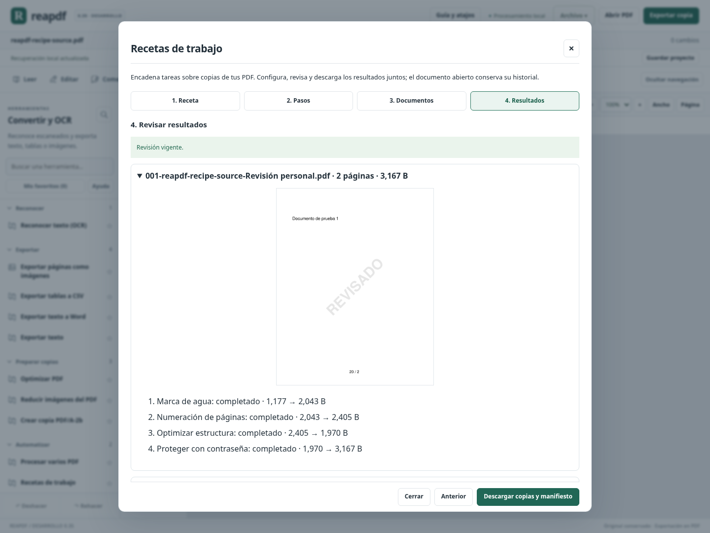
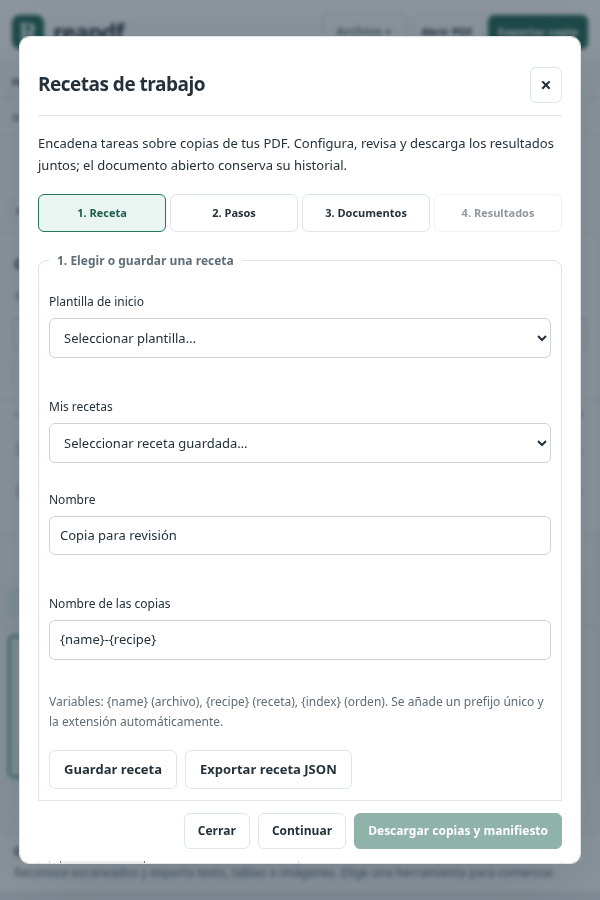
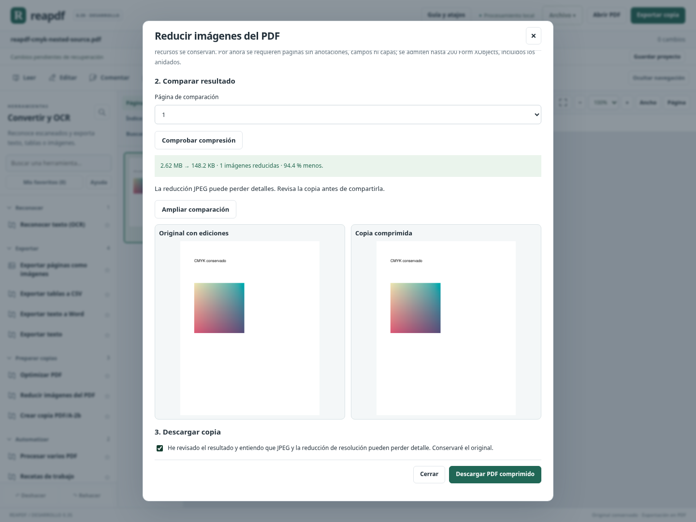

# Avance 0.35: recetas reutilizables y compresión ampliada

Este bloque añade automatización general de documentos y amplía la compresión existente. No repite como novedades los extremos o la selección múltiple de 0.34.

## Un asistente en cuatro etapas

En **Convertir y OCR → Automatizar → Recetas de trabajo**, el flujo se divide en **Receta, Pasos, Documentos y Resultados**. Cada etapa muestra sus controles; los pasos se pueden recorrer directamente con los botones superiores. Las herramientas de lotes simples siguen disponibles por separado.

1. Elegir una plantilla o crear una receta propia; poner nombre a las copias.
2. Añadir, ordenar, configurar o quitar tareas.
3. Incorporar documentos y ejecutar la revisión.
4. Ver resultados por documento, aceptar las transformaciones y descargar copias con manifiesto.

La descarga se bloquea cuando cambian pasos, documentos, opciones o contraseñas. La revisión muestra **solo la primera página** de cada PDF, junto con el resultado y tamaño de cada paso; no sustituye revisar todas las páginas de las copias antes de compartirlas. Los TXT se revisan mediante el resumen de tareas y se entregan como texto UTF-8.



## Ocho tareas combinables

| Tarea | Comportamiento y límites |
|---|---|
| Propiedades | Sustituye título, autor, asunto, palabras clave y creador. Los vacíos borran valores; quitar XML es opcional. No sanea contenido ni adjuntos. |
| Marca de agua | Texto latino vectorial, tamaño, ángulo y opacidad. Se comprueba que quepa en cada página. |
| Numeración | Pie centrado con texto y variables `{pagina}`, `{total}`, `{numero}`. Inicio y tamaño configurables; la secuencia se reinicia en cada PDF. No es Bates continuo entre documentos. |
| Reducir imágenes | Resolución y calidad JPEG configurables; se aplican los límites de la compresión descritos abajo. |
| Optimizar | Compacta estructura sin reducir resolución; el archivo puede conservar su tamaño. |
| Aplanar campos | Convierte campos compatibles en contenido fijo. Omite PDF sin campos; detiene el lote si hay campos no compatibles. |
| Extraer texto | Último paso; produce TXT sin OCR ni conservación de maquetación. |
| Proteger | Último paso; produce PDF AES-256 con permisos de copia/impresión. Las contraseñas se introducen en la ejecución. |

Los pasos se ejecutan en el orden elegido; cada tipo se admite una vez y hay hasta ocho pasos. Proteger y extraer texto son salidas alternativas, no se combinan. La compresión puede ejecutarse tras una marca de agua vectorial o después de aplanar un formulario compatible, gracias al soporte de imágenes en objetos anidados.

Las plantillas iniciales son **Copia ligera**, **Copia para revisión**, **Formulario final** y **Texto para trabajar**. No ejecutan nada por seleccionarlas: se pueden modificar y requieren revisión antes de descargar.

## Biblioteca, intercambio y nombres

Se guardan hasta 20 recetas en el navegador; guardar el mismo nombre sustituye su definición. Se pueden cargar, eliminar, importar y exportar como JSON. Las recetas se validan en el servidor, incluso cuando proceden de la biblioteca local. Se rechazan campos desconocidos, contraseñas incorporadas, tipos de tarea arbitrarios, opciones no válidas y JSON de importación de más de 64 KB. No admiten código ni scripts.

Las contraseñas permanecen en la memoria del asistente mientras está abierto: no forman parte de recetas, biblioteca, exportaciones ni manifiestos. La consola las solicita de forma interactiva. Los metadatos y textos elegidos sí forman parte de la receta; hay que tenerlo en cuenta al compartir su JSON.

Las copias admiten `{name}`, `{recipe}` y `{index}`. Se añade un prefijo numérico único y la extensión correspondiente; se eliminan rutas y caracteres no aptos y se limita el nombre, también en bytes UTF-8. Dos documentos con el mismo nombre no sobrescriben sus salidas.



## Lotes e informes

Hasta **10 PDF, 100 páginas y 60 MB** de entrada por ejecución; máximo **100 MB** de salida y por resultado intermedio. Cada función conserva sus límites más estrictos. Se validan todos los documentos antes de transformar; si falla uno, no se entrega un ZIP parcial. Los PDF firmados/restringidos conservan sus protecciones; una receta de texto sin ediciones puede leer un PDF firmado si permite copiar.

El PDF abierto incluye sus cambios aplicados; las copias no sustituyen su documento ni su historial. Los documentos adicionales se retiran del servidor al cerrar el asistente.

El ZIP incluye `manifest.json`: receta sin contraseñas, nombres, páginas, tamaños, hashes SHA-256 de entradas y salidas, cambios de sesión incluidos y resultado de cada paso. El manifiesto se genera con los bytes de esa descarga. La revisión previa puede tener otros hashes/tamaños por identificadores PDF internos o cifrado aleatorio; no debe usarse como recibo de la descarga. Las imágenes de revisión no se incorporan al ZIP ni al manifiesto.

## Ejecución local sin abrir el editor

Con el entorno de desarrollo preparado, se puede usar una receta exportada:

```bash
.venv/bin/python scripts/run_recipe.py \
  --recipe mi-receta.json --output copias.zip uno.pdf dos.pdf
```

Para generar solo un informe de revisión:

```bash
.venv/bin/python scripts/run_recipe.py \
  --recipe mi-receta.json --output revision.json --review uno.pdf
```

La consola rechaza sobrescribir una salida existente salvo con `--overwrite`; nunca permite que la salida reemplace un PDF de entrada o la propia receta. Publica el archivo al completar el proceso, retirando temporales si falla. Para proteger copias exige una consola interactiva y solicita ambas contraseñas sin incluirlas en argumentos. No se incorporan OCR, importación Office, planificación de horarios ni rangos individuales por paso en esta versión de recetas. La ejecución se ha validado en Linux; Windows sigue pendiente.

## Compresión CMYK y dentro de objetos anidados

Se amplía **Reducir imágenes del PDF** y la misma función dentro de recetas:

- Imágenes RGB, gris y **CMYK** de 8 bits, conservando espacio de color/perfil ICC compatible.
- Imágenes dentro de **Form XObjects anidados**, con hasta 200 objetos de este tipo por documento.
- Recursos compartidos entre páginas o formularios: se resamplean una vez, respetando su colocación de mayor tamaño.
- Páginas giradas y recortadas, texto y geometría conservados.

Se corrigió una inversión de muestras CMYK provocada por la combinación del codificador JPEG y la importación genérica. Las pruebas comparan la región de imagen, además de contrastar la representación con Poppler y conservar el perfil ICC. Esto no certifica impresión ni PDF/X.

Se mantienen los límites de 30 páginas, 50 imágenes, 24 MP por imagen y 64 MP inspeccionados; sin campos editables, anotaciones ni capas. La transparencia, máscaras, Decode personalizado y colores/profundidades no compatibles se conservan sin reducción; una transformación oblicua/degenerada se rechaza. Las imágenes de poca resolución tampoco se amplían. JPEG puede perder detalles. La copia debe volver a validarse si requiere PDF/A u otro estándar.



## Validación y porcentaje

Se aprobaron **1733 pruebas Python y 102 JavaScript (1835 en total)**, la compilación de producción y el recorrido completo de Chromium en Linux. Se probaron exportaciones reales y la interfaz a 600/1440 px, además de la regresión previa.

La evidencia del cierre se guarda en [validation/0.35/receipt.json](validation/0.35/receipt.json) y [CIERRE_035.json](CIERRE_035.json), con código, compilación y registros vinculados por hashes. No certifica equivalencia comercial ni ejecución Windows. La comprobación estricta sigue rechazando cerrar como versión 1.0.

**Estimación: 87,75 / 100, aproximadamente 88 % ±5 del plan propio.** Se conservan los pesos: creación/conversión/OCR pasa de 85 a 90 % (+0,75 global) por ampliar colores y recursos de imagen; herramientas profesionales/automatización pasa de 85 a 90 % (+0,5 global) por recetas configurables, biblioteca, informes y ejecución local. El resto permanece igual. No se vuelve a contabilizar cada herramienta existente como una función nueva por aparecer en recetas.

Siguientes trabajos: edición y reflujo de texto complejo; importación/conversión Office con contraste de fidelidad; formularios avanzados y accesibilidad semántica; corpus real e interoperabilidad, y validación del ejecutable propio Windows antes de la entrega personal. OCR/Office dentro de recetas se ampliarán al verificar esos motores. No se genera otro portable en este corte.
