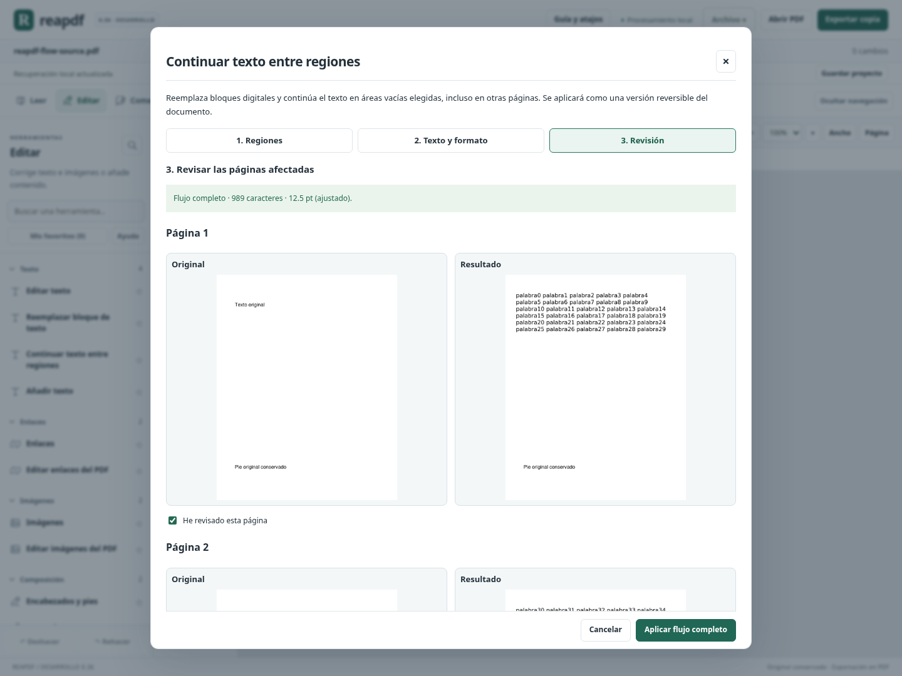
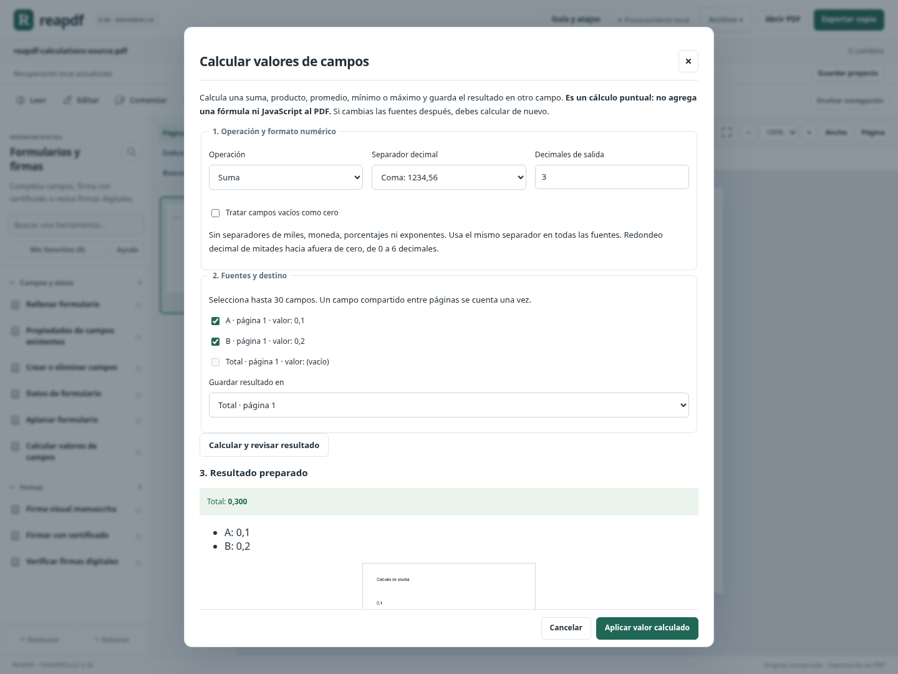

# Avance 0.36: flujo de texto, cálculos de campos y enlaces de Word

Este incremento añade tres capacidades sobre el editor existente: distribuir texto entre regiones de varias páginas, calcular valores de campos y conservar enlaces web compatibles en la exportación Word. Las recetas y la compresión de 0.35 se mantienen.

## Continuar texto entre regiones

**Editar → Texto → Continuar texto entre regiones** abre un asistente de tres etapas:

1. **Regiones:** elegir los bloques originales que se reemplazarán y las áreas vacías de continuación. Se ordenan explícitamente; se pueden subir, bajar o quitar. La detección de bloques ayuda a elegir una región original completa. La vista señala sus límites y número de orden.
2. **Texto y formato:** reunir el texto original, corregirlo y definir fuente, estilo, tamaño, interlineado y alineación. Los saltos escritos se conservan. Si se quieren unir líneas extraídas del PDF, se editan en esta etapa.
3. **Revisión:** comparar original y resultado en todas las páginas elegidas y confirmar cada una antes de aplicar.

Admite **hasta ocho regiones y 12000 caracteres** sobre páginas existentes. El flujo puede continuar dentro de otra región de la misma página o pasar a otras páginas según el orden configurado. No crea páginas ni desplaza objetos ajenos. Una región marcada para reemplazar se vacía por completo de su texto original, aunque el texto nuevo termine antes de llegar a ella: solo se deben seleccionar los bloques que se quieran sustituir.

Se elige un formato común con 12 combinaciones de familia/estilo DejaVu, cuatro alineaciones y tamaño de 6 a 72 pt. El ajuste opcional reduce el tamaño de todo el flujo en pasos de 0,5 pt hasta el mínimo elegido; el resultado informa el tamaño utilizado. Si no cabe todo el texto, rechaza el cambio completo. Las palabras demasiado largas pueden dividirse entre líneas por caracteres.

Las vistas y coordenadas muestran la página enderezada; el archivo conserva su giro y recorte originales. Los cambios de texto o formato invalidan la revisión. Aplicar genera una versión del documento que admite deshacer/rehacer, proyecto y recuperación.

### Límites del flujo

Se trabaja sobre texto digital directo. Las regiones no se solapan y deben quedar dentro de la página. Las continuaciones deben estar vacías de texto, imágenes, campos y anotaciones. Se rechazan cruces con gráficos vectoriales o enlaces, páginas con Form XObjects y documentos con capas o etiquetas semánticas. No se modifica un bloque que corte parcialmente el texto original. Se respetan firmas, permisos y censuras pendientes.

El texto original se sustituye por la fuente incrustada elegida; no conserva formato mixto dentro del flujo. Se rechazan caracteres sin glifo y escritura de derecha a izquierda. No es reflujo automático de todo el documento ni edición de una página escaneada. Las regiones marcadas no son una herramienta de censura certificada.

## Calcular valores de campos

**Formularios y firmas → Campos y datos → Calcular valores de campos** añade suma, producto, promedio, mínimo y máximo. Se eligen de 1 a 30 fuentes y un campo de destino distinto. Solo se ofrecen campos de texto de una línea, editables y compatibles; un campo lógico compartido entre páginas se cuenta una vez.

El cálculo usa aritmética decimal, separador de coma o punto explícito y salida de 0 a 6 decimales. No interpreta separadores de miles, monedas, porcentajes ni exponentes. Los campos vacíos provocan un error, salvo que se active expresamente **Tratar campos vacíos como cero**. Valores y resultados se limitan a ±10¹²; el producto también comprueba sus resultados intermedios.

El redondeo de mitades se hace hacia afuera de cero: 1,005 → 1,01 y −1,005 → −1,01 al pedir dos decimales. La revisión muestra los valores leídos, el resultado y su apariencia dentro del formulario. Cambiar la operación, las fuentes, el destino o las opciones invalida la revisión; aplicar requiere aceptación.

El resultado se guarda como **valor nativo del campo**, junto a las ediciones anteriores, con historial, proyecto y recuperación. Se sincronizan los Widgets de un destino compartido. Se comprueban longitud y espacio del campo; se conservan sus restricciones. Si el valor ya coincide y no hay cambios, no se añade una entrada de historial nueva.

**Es un cálculo puntual:** no guarda una fórmula y no se recalcula automáticamente al modificar fuentes. Los formularios con XFA, scripts o fórmulas PDF preexistentes siguen protegidos. No se sobrescriben campos de solo lectura ni documentos firmados.

## Enlaces web en la exportación Word

En **Convertir y OCR → Exportar → Exportar texto a Word** se puede activar **Conservar enlaces web en Word**. Exporta enlaces HTTP/HTTPS que contienen fragmentos completos de texto, con su dirección exacta y formato básico; se verifican páginas giradas y recortadas. No realiza solicitudes de red para abrir esas direcciones.

La revisión informa cuántos enlaces se conservaron y qué casos se omitieron. Los destinos internos o de archivo, esquemas no web, direcciones con credenciales y coincidencias parciales o ambiguas no se adivinan. Si un enlace cruza solo parte de un fragmento, esa parte queda como texto sin enlace y aparece un aviso. Los enlaces de celdas transformadas en tablas tampoco se reconstruyen automáticamente. La opción es independiente de imágenes, tablas y saltos de línea.

Esto mejora la exportación editable, pero no implementa importación Office ni garantiza maquetación idéntica en Word. Sigue siendo necesaria la revisión en la aplicación de destino.

## Validación y cierre

Se aprobaron **1839 pruebas Python y 103 JavaScript (1942 en total)**, la compilación de producción y el recorrido completo de Chromium sobre Linux. El entorno quedó ejecutando la versión 0.36.

La evidencia local se conserva en [validation/0.36/receipt.json](validation/0.36/receipt.json) y [CIERRE_036.json](CIERRE_036.json). Incluye código, compilación y registros vinculados por hashes; no certifica ejecución en Windows ni equivalencia universal con Acrobat.

Se comprueban palabras completas y ausencia del texto reemplazado, giros/recortes, conservación de una página ajena incluso con recursos compartidos, métricas de 12 fuentes/estilos, líneas vacías y desbordamiento. Poppler contrasta el texto del PDF. Se prueban cálculos decimales, fuentes pendientes de aplicar, campos compartidos, permisos y proyectos. Un lector OOXML independiente comprueba texto, estilos y direcciones de los hipervínculos. Chromium descarga los archivos, revisa invalidación de opciones, deshacer/rehacer y recuperación; verifica la interfaz de flujo a 600 px y el recorrido general previo.

**Estimación: 88,75 / 100, aproximadamente 89 % ±5 del plan propio.** Se mantienen los pesos: edición de texto/imágenes pasa de 85 a 90 % por el flujo explícito entre regiones (+1 punto global). Las mejoras de formularios y Word profundizan áreas ya contabilizadas y no vuelven a sumar familias completas. Las otras áreas conservan su estimación. El cierre 1.0 continúa pendiente.

## Siguientes trabajos recomendados

1. Importación DOCX a PDF con validación de fuentes, imágenes, tablas y pérdidas de diseño; contraste en Word/LibreOffice.
2. Reflujo con formato mixto y estructuras más complejas, conservando objetos y etiquetas semánticas.
3. Fórmulas automáticas de formularios con dependencias y actualización verificadas, junto a accesibilidad y corpus real.
4. Prueba del ejecutable propio en Windows antes de la entrega personal. No se genera un nuevo portable en este corte.
