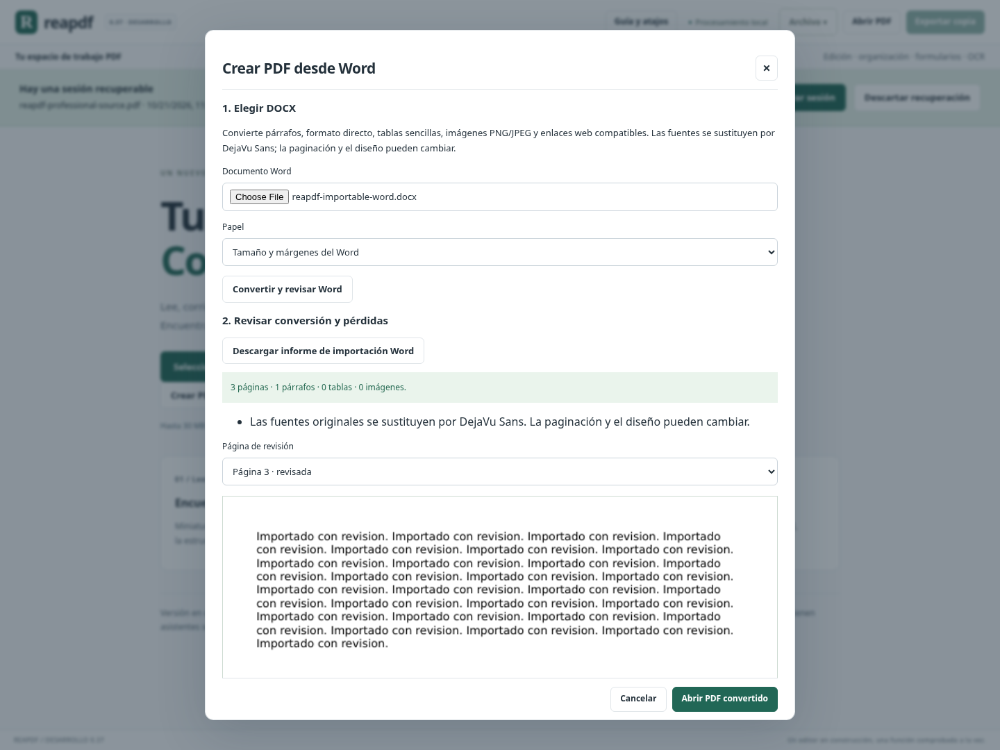
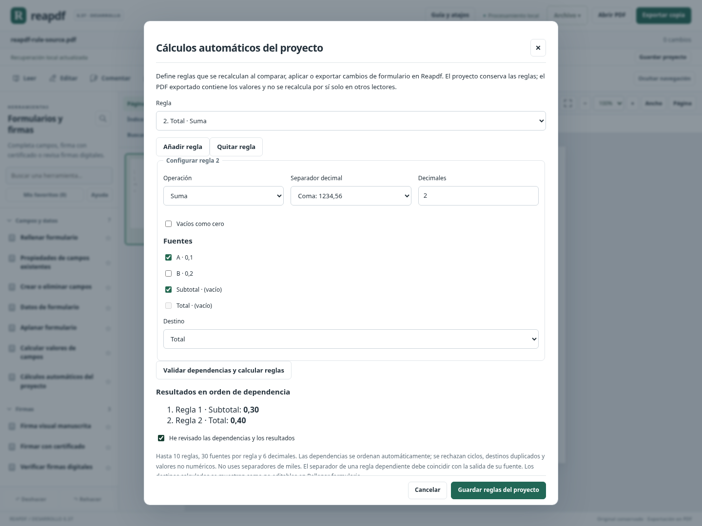

# Avance 0.37: importar Word, reglas de cálculo y Word en recetas

Este bloque añade una dirección nueva de conversión —DOCX a PDF—, reglas con dependencias para proyectos de formulario y salida Word en automatizaciones. Incluye revisión por páginas, informes descargables y pruebas de edición y recuperación.

## Crear PDF desde Word sin instalar Office

En la bienvenida o en **Archivo → Crear PDF desde Word**, el asistente admite DOCX estándar de hasta **10 MB**. La conversión se ejecuta localmente con el motor ya incluido en Reapdf; no abre Office ni descarga imágenes u otros recursos externos.

Se incorporan párrafos con texto seleccionable, negrita/cursiva/tamaño/color directos, alineación básica, tablas rectangulares, imágenes PNG/JPEG compatibles y enlaces HTTP/HTTPS. Se puede elegir tamaño y márgenes del Word, A4 o Carta. La fuente se sustituye por DejaVu Sans incrustada. El resultado puede editarse con las herramientas PDF compatibles; no se entrega una captura rasterizada de cada página.

### Revisión antes de abrir

1. Elegir el DOCX y el papel, y pulsar **Convertir y revisar Word**.
2. Leer el informe de contenido y omisiones; revisar y marcar cada página generada.
3. Aceptar las diferencias declaradas y abrir el PDF convertido.

Cambiar archivo o papel descarta la conversión temporal anterior. La descarga JSON incluye huellas SHA-256 de Word y PDF, tamaños, contenido incorporado, fuentes sustituidas, avisos y diferencias detectadas en las palabras del contenido admitido. La huella del PDF coincide con la copia exportada antes de editarla. No es una certificación de fidelidad visual de Word.

La conversión no sustituye el documento abierto hasta pulsar **Abrir PDF convertido**. Si hay cambios o una sesión recuperable que se reemplazaría, se ofrece conservarlos antes de continuar. Las conversiones temporales se retiran al cerrar o cambiar opciones. Una vez abierto el PDF, se puede exportar una copia y guardar un proyecto.

### Alcance y omisiones

La conversión **no conserva maquetación exacta**. Los estilos heredados, numeración/listas, encabezados/pies, notas y comentarios no se reconstruyen; se informa de su omisión o sustitución. Las tablas con celdas fusionadas pasan a texto por filas; las tablas anidadas se omiten con aviso. Los campos automáticos compatibles aportan el texto de su resultado guardado y no se actualizan. Los saltos manuales no garantizan la misma paginación. Las imágenes flotantes pasan al flujo de texto y se ajustan al espacio disponible.

Las imágenes recortadas, giradas o reflejadas se omiten con aviso. Así se evita mostrar partes que estaban fuera del recorte o cambiar silenciosamente su orientación. Las imágenes externas, SVG y otros formatos no compatibles no se descargan ni se reconstruyen. Se rechazan macros, objetos Office incrustados y control de cambios sin resolver.

Límites adicionales: 400 recursos, 40 MB descomprimidos, 2 MB y 50000 elementos por parte XML, hasta 50 páginas, 100000 caracteres, 3000 párrafos, 50 tablas y 3000 celdas. Imágenes: 50, 20 MP por imagen y 60 MP acumulados. Solo XML UTF-8 sin entidades/DTD; los caracteres sin glifo se rechazan. El corpus de Word real y el contraste visual con Word/LibreOffice continúan pendientes.

## Cálculos automáticos en proyectos de Reapdf

En **Formularios y firmas → Campos y datos → Cálculos automáticos del proyecto**, se pueden definir hasta **10 reglas**, cada una con hasta 30 fuentes. Admiten suma, producto, promedio, mínimo y máximo, separador decimal explícito, de 0 a 6 decimales y tratamiento opcional de vacíos como cero.

Una regla puede tomar como fuente el resultado de otra. Reapdf obtiene el orden de dependencias, independientemente del orden de la lista. Rechaza ciclos directos o indirectos, dos reglas para un destino, referencias incompatibles y valores no numéricos. Conserva límites, redondeo decimal y restricciones de los cálculos puntuales de 0.36.

Ejemplo: `Subtotal = A + B`, `Total = Subtotal + A`. Con A=0,1 y B=0,2, devuelve Subtotal=0,30 y Total=0,40. Cambiar A a 1,5 y comparar el formulario actualiza Subtotal=1,70 y Total=3,20.

Las reglas se revisan antes de guardar y se conservan en `.reapdf`, historial y recuperación. En **Rellenar formulario**, los destinos calculados se muestran como no editables; después de comparar se actualizan sus valores visibles. Las reglas se evalúan al comparar, aplicar o exportar las ediciones. No se ejecuta código arbitrario ni JavaScript del PDF. Los formularios con scripts o cálculos PDF preexistentes siguen protegidos.

### Dónde permanecen las reglas

**El proyecto Reapdf conserva las reglas; el PDF exportado conserva los valores.** Un lector externo no recalcula estos campos automáticamente. Si se vuelve a abrir solo el PDF, los campos contienen los valores exportados y no estas reglas de proyecto.

Las operaciones que crean una versión materializada del PDF —por ejemplo, organizar páginas o modificar su estructura— conservan los valores y dejan las reglas en el estado anterior del historial. La interfaz avisa mientras hay reglas activas; Deshacer o abrir el proyecto anterior permite recuperarlas. Remapear reglas entre esas versiones sigue pendiente. Las anotaciones y los cambios de valores que conservan el PDF base mantienen las reglas activas.

Retirar reglas restaura los valores base o manuales de la sesión. Exportar datos de formulario JSON refleja los resultados vigentes, no valores de destino obsoletos. Los cálculos puntuales pueden leer resultados calculados como fuentes, pero no sobrescribir un destino que pertenece a reglas activas.

## Word como salida de una receta

En **Convertir y OCR → Automatizar → Recetas de trabajo**, se incorpora **Convertir a Word editable**. Debe ser el último paso y admite sus opciones de líneas, imágenes, tablas y enlaces web. Se puede combinar, por ejemplo, con propiedades, numeración o aplanado compatible antes de generar el DOCX.

El ZIP contiene un Word por documento y un manifiesto con las huellas de los bytes realmente descargados. El resultado de cada paso Word incluye páginas, caracteres, imágenes, tablas, enlaces y sus omisiones. La revisión presenta el resumen por documento; no ofrece una vista de Word renderizada. Las copias deben abrirse en Word o un lector compatible para revisar el formato.

La receta sigue limitada a ocho pasos y conserva las versiones JSON existentes. Word es una salida alternativa a TXT o PDF protegido; no se encadena después de otra salida terminal. Una receta que solo convierte a Word puede leer un PDF firmado si permite copiar. Las tareas previas que modifican documentos conservan sus requisitos de permisos. No realiza OCR automáticamente ni importa varios DOCX a la vez.

## Validación y estimación

Se aprobaron **1878 pruebas Python y 105 JavaScript (1983 en total)**, la compilación de producción y el recorrido completo de Chromium en Linux. Son 41 pruebas netas más que en 0.36.

La evidencia del cierre queda en [validation/0.37/receipt.json](validation/0.37/receipt.json) y [CIERRE_037.json](CIERRE_037.json). Las pruebas incluyen importación de texto/estilos/imágenes/tablas, enlaces, paginación, límites, entidades, macros, rutas, recortes omitidos y edición posterior; dependencias de reglas, ciclos, campos, proyectos, datos JSON y materialización de valores; salidas Word de recetas con manifiestos. Poppler contrasta texto y los paquetes OOXML se inspeccionan de forma independiente al renderizado PDF.

Chromium prueba conversión revisada en todas sus páginas, recibo con hash de la copia real, reglas dependientes y cambios de fuentes desde el editor normal, historial, proyecto, recuperación y ventana de 600 px. Se conserva el recorrido completo anterior. Estas pruebas se ejecutan en Linux; Windows continúa pendiente.

**Estimación del plan: 89,5 / 100, aproximadamente 90 % ±5.** Se conservan los pesos. Creación/conversión/OCR pasa de 90 a 95 % por la nueva dirección DOCX→PDF compatible (+0,75 global). Formularios permanece al 95 % y automatización al 90 %: se amplían subcapacidades, sin volver a sumar familias completas. Distribución permanece al 55 %; no se atribuye ejecución Windows ni fidelidad universal de Office. El checklist sigue rechazando declarar 1.0.

## Siguientes trabajos concretos

- Estilos heredados, listas, encabezados/pies y corpus de Word con contraste visual independiente.
- Conservar reglas mediante remapeo al reorganizar páginas y editar estructuras de campos; fórmulas nativas e interoperabilidad con lectores.
- Reflujo con formato mixto y etiquetas semánticas; accesibilidad y documentos complejos.
- Validar el ejecutable propio en Windows antes de la entrega personal. No se genera otro portable en este corte.
