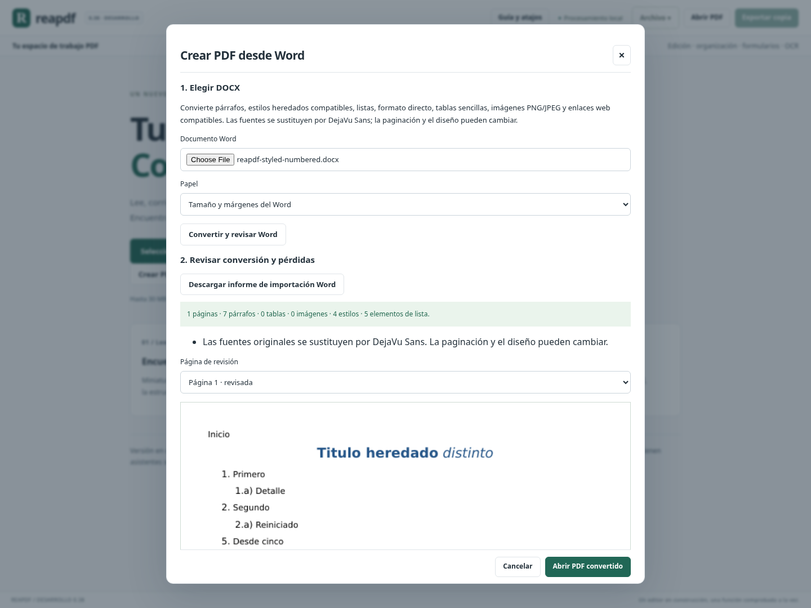
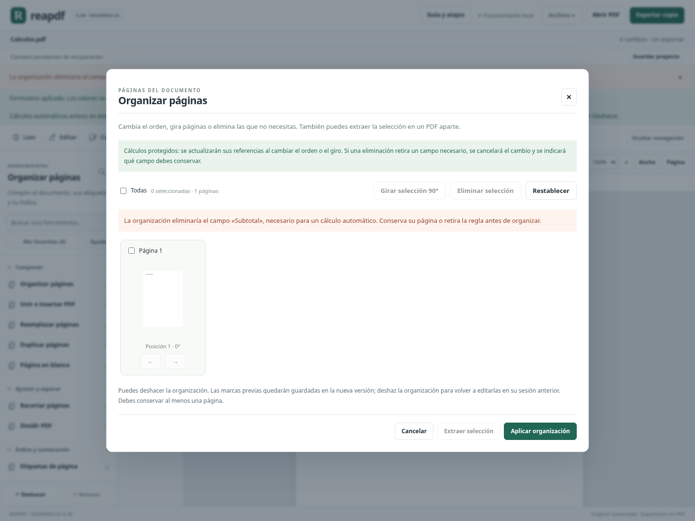

# Avance 0.38: estilos y listas Word; cálculos protegidos al organizar páginas

Este bloque cierra dos pendientes concretos de 0.37: la importación ahora interpreta herencia compatible de estilos y numeración, y organizar páginas conserva las reglas de cálculo del proyecto en la nueva versión. Añade formato de párrafo y avisos contextuales, con comprobaciones de salida y recuperación.

## Word: estilos heredados y formato de párrafo

En **Archivo → Crear PDF desde Word**, el asistente interpreta los valores predeterminados del documento, estilos de párrafo y carácter y sus cadenas `basedOn`. Conserva, dentro del alcance compatible, negrita, cursiva, subrayado, tachado, tamaño, color y alineación. El formato directo tiene prioridad. Las propiedades de alternancia de Word, como negrita/cursiva en estilos sucesivos, se resuelven como tales; desactivarlas directamente en un fragmento tiene efecto.

Se incorporan espaciado anterior/posterior en puntos, sangrías izquierda/derecha y primera línea/francesa. Las propiedades compuestas —por ejemplo, un identificador de lista heredado y un nivel explícito— se combinan por sus atributos o hijos compatibles. Los estilos ausentes o de otro tipo generan aviso. Las herencias circulares, repetidas o excesivas se rechazan antes de incorporar el resultado.

Las fuentes continúan sustituyéndose por DejaVu Sans incrustada. No se garantiza la misma paginación ni maquetación de Word. El interlineado/espaciado automático, saltos y agrupación de párrafos no se reproducen exactamente y generan advertencias cuando se detectan. No se crean etiquetas semánticas por convertir un estilo de título.

## Word: listas, niveles y reinicios

La importación admite listas decimales, letras y romanos en mayúsculas/minúsculas y viñetas compatibles. Interpreta hasta nueve niveles, plantillas como `1.a)`, valores iniciales y excepciones de inicio. Mantiene contadores por instancia de lista; al avanzar un nivel superior se reinician los inferiores según el comportamiento básico compatible. Permite retirar la numeración con `numId=0`.

Ejemplo comprobado: **1. Primero → 1.a) Detalle → 2. Segundo → 2.a) Reiniciado**, más otra lista que empieza en **5**. Los marcadores se escriben como texto seleccionable en el PDF y se incluyen en la comprobación de contenido. No son formularios ni campos automáticos PDF.

Se conservan viñetas estándar compatibles; una viñeta dependiente de fuente especial se sustituye por un punto y se informa. Formatos desconocidos, enlaces a estilos de numeración, referencias a niveles ausentes o semánticas de reinicio explícitas no admitidas conservan el texto del párrafo y generan aviso de numeración omitida. No se inventa la secuencia de una lista incompatible.

El informe JSON y el resumen del asistente incluyen **estilos aplicados** y **elementos de lista incorporados**, además de las huellas, comprobación de texto y omisiones anteriores. Se mantiene la revisión obligatoria de cada página antes de abrir el PDF.

Límites adicionales: hasta 1000 definiciones de estilos y 32 niveles de herencia, 1000 numeraciones/definiciones abstractas, inicio entre 0 y 9999; romanos entre 1 y 3999 y letras entre 1 y 18278 cuando se renderizan esos formatos. Todas las partes nuevas pasan por el lector XML acotado, sin entidades/DTD. Se conservan los límites de tamaño, recursos, páginas, imágenes y caracteres de 0.37.

## Reglas de cálculo que sobreviven a la organización

En **Organizar páginas**, ordenar, girar y eliminar páginas actualiza las referencias de las reglas compatibles. Los identificadores internos PDF pueden cambiar al guardar: el motor utiliza el nombre completo único del campo lógico y las páginas que realmente sobreviven, comprueba la pertenencia del grupo y valida de nuevo todos los cálculos antes de guardar la versión.

- Las reglas permanecen activas en la versión nueva; los otros cambios aplicados se incorporan al PDF base, sin repetirse.
- Cambiar una entrada desde **Rellenar formulario** sigue actualizando subtotales y totales después de ordenar/girar.
- Se pueden eliminar páginas independientes de las fórmulas.
- Si un campo compartido conserva una aparición en otra página, la regla se reasigna al campo lógico superviviente.
- Si desaparece un campo necesario, aparece su nombre y se rechaza la organización completa. El original y el estado aplicado continúan disponibles. No se guarda una versión parcial.
- Si aparecen nombres ambiguos o miembros incompatibles, se rechaza la reasignación; no se elige un destino por aproximación.

El organizador explica esta protección mientras existen reglas. Al completar el cambio, confirma que siguen activas. Proyecto `.reapdf`, historial y recuperación conservan las referencias actualizadas. El PDF exportado sigue conteniendo **valores**, sin JavaScript ni reglas nativas que otros lectores recalculen.

**Alcance preciso:** esta conservación se aplica a ordenar, girar y eliminar desde **Organizar páginas**. Insertar/reemplazar/duplicar, recortar, editar estructuras de campos y otras operaciones que crean nuevas versiones todavía conservan resultados y dejan las reglas en el estado anterior del historial. El aviso de sesión distingue ambos casos. El remapeo no se ha generalizado a estas transformaciones.

## Validación

Cierre: **1914 pruebas Python y 105 JavaScript**, compilación de producción y recorrido completo de Chromium en Linux. Las 36 pruebas nuevas cubren renderizado real de estilos/listas, alternancias y anulaciones directas, contadores/reinicios, viñetas, valores predeterminados, geometría por espaciado, partes XML y grafos inválidos; remapeo de reglas, edición posterior, grupos compartidos, rechazo atómico, API y proyectos. Poppler verifica texto y marcadores de salida independientemente del extractor del motor cuando está disponible.

El recorrido nuevo de Chromium importa Word con cuatro estilos y cinco elementos de lista, revisa y abre el PDF; restaura un proyecto con reglas, ordena/gira sus páginas, cambia una entrada y comprueba el total; intenta eliminar su página necesaria y comprueba el rechazo; elimina una página independiente y verifica proyecto, deshacer/rehacer y recuperación tras recargar. También comprueba el organizador a 600 px. Se mantiene la regresión completa previa.

Evidencias ligadas al código, compilación y registros: [validation/0.38/receipt.json](validation/0.38/receipt.json) y [CIERRE_038.json](CIERRE_038.json). Las pruebas no equivalen a validar Office complejo o ejecutar el programa en Windows.

## Estimación y siguientes trabajos

**89,5 / 100, aproximadamente 90 % ±5.** Se conservan los pesos y coberturas de 0.37: este corte amplía y corrige familias ya contabilizadas; no vuelve a sumar Word ni formularios como áreas nuevas. No se declara 1.0 ni se genera otro portable.

Siguientes bloques recomendados:

1. Remapear reglas al insertar/reemplazar páginas y modificar nombres/estructura de campos, con tratamiento explícito de dependencias eliminadas.
2. Encabezados/pies y más estructuras Word, con documentos reales y contraste visual en Word/LibreOffice.
3. Reflujo con formato mixto y conservación semántica en documentos compatibles.
4. Validación del ejecutable propio en Windows: arranque con logo, apertura, edición, impresión, exportación y recuperación antes de la entrega personal.
