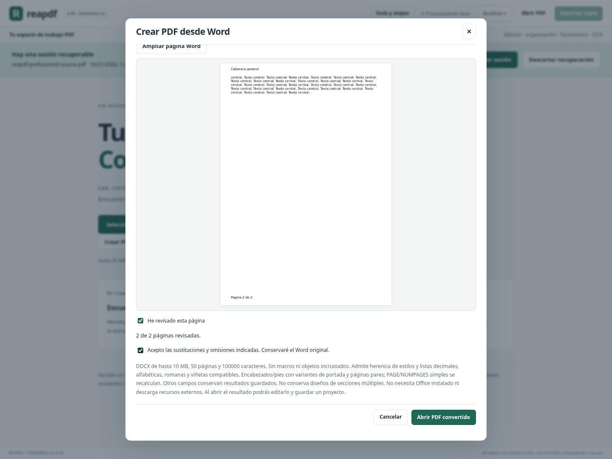

# Avance 0.39: continuidad de cálculos, encabezados Word y revisión de página

Este bloque amplía la conservación de cálculos a operaciones que antes los dejaban en el historial y añade encabezados/pies a la importación Word. También mejora la vista previa de conversión para inspeccionar páginas completas o ampliadas.

## Continuar trabajando sin perder las reglas

Las reglas de proyecto permanecen activas en las siguientes operaciones compatibles:

| Operación | Comportamiento comprobado |
|---|---|
| Insertar otro PDF | Se actualizan las páginas de los campos originales; los campos importados siguen siendo independientes. |
| Reemplazar páginas | Se conservan las reglas de los campos originales supervivientes. Retirar un campo necesario rechaza el cambio completo. |
| Duplicar páginas | Las fórmulas continúan en los originales. Las copias conservan sus valores, con identidades independientes, sin heredar reglas accidentalmente. |
| Añadir hojas en blanco | Se actualizan las referencias desplazadas por las nuevas páginas. |
| Recortar/restaurar límites | Se conservan las reglas si los campos necesarios siguen siendo editables y visibles. Un recorte incompatible se rechaza. |
| Renombrar campos | Se actualizan fuentes, destinos y dependencias intermedias, incluidos nombres jerárquicos y campos compartidos compatibles. |
| Cambiar propiedades | Se conservan las reglas al cambiar posición, descripción y formato compatibles. Bloquear un campo necesario o dejarlo sin espacio/longitud suficiente se rechaza. |
| Crear/eliminar campos | Añadir o retirar campos independientes mantiene las reglas. Eliminar un campo necesario se rechaza. |

Esto se suma a ordenar, girar y eliminar páginas desde el organizador, incorporado en 0.38. Las nuevas versiones conservan las reglas y materializan los demás cambios aplicados; estos no se repiten sobre el nuevo PDF base.

La correspondencia utiliza el nombre lógico único, los miembros compartidos y un mapa explícito de las páginas originales supervivientes. No utiliza el nombre de una copia para reemplazar una dependencia eliminada. Al renombrar, se identifica además el campo desde la versión que inspecciona el editor: rellenar formularios puede cambiar los identificadores internos PDF, por lo que se comprueba la identidad lógica antes de actualizar el grafo.

### Ejemplo de continuidad

Con **Subtotal = A + B** y **Total = Subtotal + A**, A=0,1 y B=0,2 producen Total=0,40. Se puede insertar una hoja al principio, renombrar A como Importe, reemplazar una hoja independiente y duplicar la página del formulario. Cambiar Importe a 2 sigue produciendo Total=4,20 en el original; la copia conserva Total=0,40 y no se recalcula con la entrada del original.

Las propiedades de campos revisan las dependencias tanto en **Vista previa** como al aplicar. Los cambios incompatibles no crean una versión parcial ni sustituyen el proyecto abierto. Los asistentes explican la conservación y las restricciones; la confirmación indica que los cálculos siguen activos. Proyecto, deshacer/rehacer y recuperación tras recargar conservan las referencias nuevas.

**Límite importante:** siguen siendo reglas del proyecto Reapdf. El PDF exportado contiene valores, sin fórmulas PDF/JavaScript que otros lectores recalculen. Operaciones no incluidas en la tabla —como aplanar, firmar o algunas transformaciones de contenido— materializan resultados y dejan las reglas en el estado anterior del historial. No se ha generalizado su conservación a todas las herramientas.

## Word: encabezados y pies compatibles

**Archivo → Crear PDF desde Word** incorpora partes internas de encabezado y pie referenciadas por la sección importada. Admiten texto con estilos compatibles, tablas rectangulares, imágenes PNG/JPEG y enlaces web según los límites del importador. Las relaciones de imágenes/enlaces se resuelven por cada parte; no se confunden con las del cuerpo ni se descargan recursos externos.

Se interpretan variantes **general**, **primera página** y **páginas pares**. Las variantes especiales siguen las opciones de portada y pares del Word. Si una variante activa no tiene pie o encabezado correspondiente, esa zona queda vacía, sin inventar contenido. Las partes que no están referenciadas en la sección importada se declaran como no incorporadas.

Se mide el contenido antes de distribuir el cuerpo y se reserva espacio para evitar superposiciones. Si es necesario, aumenta el espacio reservado en los márgenes; el tamaño de papel elegido se conserva. Un encabezado/pie que excede el ancho o **144 pt de alto**, o deja menos de 72 pt para el cuerpo, provoca un error en lugar de entregar una zona recortada.

### Número de página y total

Los campos **simples** OOXML `PAGE` y `NUMPAGES`, con la variante compatible `MERGEFORMAT`, se sustituyen por el número y total de páginas del PDF generado. Conservan el formato de texto compatible del campo. Se calcula primero la paginación del cuerpo con sus espacios reservados, y después se dibujan los valores definitivos.

La numeración empieza en 1 y usa las páginas reales del PDF; no reproduce reinicios de sección ni numeración especial. Los campos complejos formados por instrucciones repartidas entre fragmentos, otros formatos o comandos conservan únicamente sus resultados guardados con aviso. No se ejecutan instrucciones Office, fórmulas arbitrarias ni descargas.

Los encabezados/pies se escriben como contenido PDF nativo. Las páginas no se rasterizan ni se superponen como Form XObjects completos; el texto del cuerpo continúa seleccionable y editable con las herramientas compatibles. Los enlaces web repetidos se conservan en las páginas correspondientes.

El informe incluye **plantillas de encabezado/pie**, **apariciones dibujadas** y **campos de página reconocidos**, además de los conteos anteriores. La comprobación de texto considera las variantes que realmente aparecen y sus repeticiones, sin declarar pérdidas por una variante inactiva. Se mantiene la revisión de todas las páginas y el recibo con huellas de Word y PDF.

### Alcance restante

La importación sigue sin garantizar la misma maquetación de Word. Se usan las fuentes incluidas en Reapdf y una distribución compatible. En documentos con secciones múltiples, se utiliza el tamaño común y los encabezados/pies de la última sección; se informa de esa sustitución. Notas al pie, comentarios, objetos y estructuras no compatibles conservan sus restricciones anteriores.

Las partes nuevas pasan por los límites XML y de recursos existentes. Distancias de encabezados/pies: 0–144 pt. Revisiones pendientes, objetos, relaciones externas de encabezados, partes dañadas y zonas que no caben se rechazan. Imágenes externas y formatos no compatibles no se descargan. El corpus real y el contraste visual con Word/LibreOffice siguen pendientes.

## Revisión de Word más práctica

La vista inicial muestra **la página completa ajustada** al espacio del asistente, incluidos encabezado y pie. **Ampliar página Word** cambia a una vista mayor con desplazamiento; **Ajustar página Word** vuelve a la vista completa. Las imágenes de revisión se solicitan a escala 1,5 y 2 respectivamente para evitar ampliar una miniatura de baja resolución.

Cambiar entre ambas vistas mantiene la página y su marca de revisión; espera la carga de la nueva imagen. El asistente continúa exigiendo revisar todas las páginas y aceptar las diferencias antes de abrir el PDF. Se comprueban el ajuste y la ausencia de desbordamiento horizontal a 600 px.

## Validación y evidencia

Cierre: **1959 pruebas Python y 105 JavaScript (2064 en total)**, compilación de producción y recorrido completo de Chromium en Linux. Son **45 pruebas Python nuevas**, además de ampliar el recorrido de interfaz.

Las pruebas nuevas cubren las transformaciones de páginas, copias independientes, eliminación/reemplazo/recorte atómicos, renombrado de fuentes/destinos/intermedios, identificadores cambiantes, jerarquías y campos compartidos, vista previa y proyectos. Para Word cubren repetición, variantes, estilos de campos de página, papel, relaciones locales, imágenes, enlaces, XML/revisiones/objetos no admitidos, distancias, desbordamientos y edición posterior del cuerpo. Poppler contrasta el texto de salida cuando está disponible.

Chromium ejecuta un flujo encadenado de inserción, renombrado, reemplazo, duplicación, relleno y cálculo, comprueba las copias mediante el proyecto descargado y verifica historial/recuperación. También revisa todas las páginas Word, descarga el PDF, comprueba encabezados y numeración, alterna las vistas y valida el asistente y las propiedades a 600 px. Continúa la regresión completa anterior.

Como comprobación adicional, un DOCX producido con una biblioteca independiente, con encabezado, pie y campos simples, generó cinco páginas con numeración correcta y sin diferencias en la comprobación de texto. Esto no sustituye un corpus de documentos reales ni un contraste visual en Office.

Evidencia ligada al código y a los registros: [validation/0.39/receipt.json](validation/0.39/receipt.json) y [CIERRE_039.json](CIERRE_039.json). Windows permanece sin validación de ejecución. No se genera un nuevo portable.

## Estimación y siguientes trabajos

**89,5 / 100, aproximadamente 90 % ±5.** Se conservan los pesos y las coberturas anteriores: este bloque completa subflujos dentro de Word y formularios ya contabilizados; no vuelve a sumar esas familias como áreas nuevas. No se declara 100 %, equivalencia universal con Acrobat ni versión 1.0.

Siguientes trabajos recomendados:

1. Reflujo con formato mixto: conservar estilos de varios fragmentos entre regiones, con vista previa y comprobación de texto/desbordamientos.
2. Secciones y campos complejos Word, con corpus real y comparación visual independiente.
3. Fórmulas PDF interoperables y validación avanzada de firmas —revocación y sellado de tiempo— dentro de sus alcances comprobables.
4. Ejecutar y validar el programa propio en Windows antes de preparar la entrega personal: arranque, abrir/editar/exportar, imprimir y recuperar trabajo.
