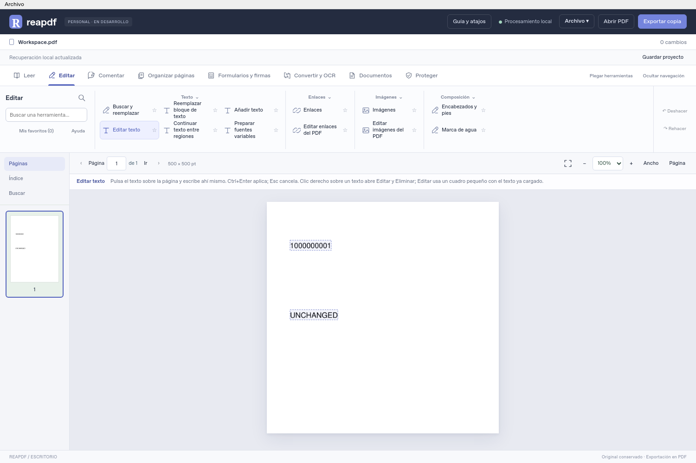

# Interfaz personal con barra de tareas · 5 de noviembre de 2026

La distribución cambia: las herramientas dejan de ocupar una columna lateral permanente y pasan a una barra superior agrupada por tarea. A la izquierda quedan páginas, índice y búsqueda; las propiedades aparecen a la derecha cuando la herramienta las necesita. El documento dispone de más ancho. La organización habitual de editores líderes y las capturas aportadas sirven de referencia de interacción; Reapdf conserva identidad visual propia y funcionamiento personal local.

## Organización y uso

- Cabecera oscura, superficies neutras, un acento azul suave y selección de tarea con subrayado. El indicador de desarrollo sustituye la versión 0.41 obsoleta de la cabecera; no cambia el número del paquete ni anuncia una versión estable.
- Elige **Editar**, **Comentar**, **Organizar páginas**, **Formularios y firmas**, **Convertir y OCR**, **Documentos** o **Proteger**. Solo se presentan los grupos de esa tarea. Los títulos de grupo se pueden plegar y tienen indicador de estado.
- La barra utiliza el catálogo único de 75 herramientas. Se conservan búsqueda por tarea, Ctrl+K, favoritos, ayuda, permisos y explicaciones de incompatibilidad. No se añaden botones duplicados que simulen capacidades nuevas.
- **Plegar herramientas** amplía la zona del documento; **Mostrar herramientas** restaura la barra. La preferencia se guarda localmente cuando el almacenamiento del modo de ejecución está disponible. Ctrl+K sigue accesible con la barra plegada.
- El control de páginas y el zoom permanecen sobre el lienzo; miniaturas, índice y búsqueda quedan en la navegación izquierda. Las propiedades son contextuales. Las ventanas estrechas desplazan los grupos y sitúan las propiedades debajo del documento.
- El modo de lectura ampliada oculta barra y paneles y vuelve a la distribución anterior al salir. Una regresión de solapamiento de la barra nueva se reprodujo, corrigió y añadió a la prueba Qt.

El cuadro compacto se ve en [esta captura de la ventana Qt](validation/studio-ui-20261105/quick-edit.png), con una muestra ficticia.

Se mantiene **clic derecho sobre texto → Editar → cuadro pequeño precargado → Aplicar/Ctrl+Enter**, además de la edición directa con cursor. Cancelar conserva el original; un error mantiene el borrador; Eliminar admite Deshacer y no sustituye a la censura. Detalles del motor incorporado en [edición accesible y rápida](EDICION_ACCESIBLE_Y_RAPIDA_20261105.md).

## Verificación

Fuente exacta `723b281b6b7b7dd37b436cada9b3aebbd633c187`, respaldada en `recovery/editing-20261029`. **38 recorridos Qt aprobados en Linux y Windows Server 2025**, con fuente limpia antes y después; comprobante `42068614449-1` contrastado con los objetos Git y hashes. **Diez aperturas independientes del ejecutable Windows** aprobadas, incluidas edición Stm/ActualText, continuación desde Form y cuadro rápido/eliminación. Exportan por el servidor real del paquete y reabren por su intérprete; el guardado nativo se comprueba desde fuente Qt, sin atribuir ese diálogo al recorrido compilado.

**151 pruebas JavaScript, build, manual 75+15 y 34 pruebas Python dirigidas de comprobantes/vinculación aprobados.** Las pruebas de protocolo de comprobantes no sustituyen la ejecución real Windows. La regresión Python de 4.662 pruebas y tres avisos corresponde a `7d37c20eb2b77de518e8253f8d3b4aba52ed5183`; los árboles Git de backend, portable y tests permanecen idénticos. No se repite esa regresión por cambios de CSS y distribución ni se atribuye su ejecución a otra revisión. Evidencia completa y SHA256 en [results.json](validation/studio-ui-20261105/results.json).

El recorrido nuevo utiliza ratón real de Qt, selecciona la tarea y el texto original, prueba plegado y restauración, persistencia tras recargar interfaz y reabrir la muestra, lectura ampliada y tamaños 1500×1000, 1280×760 y 900×760 sin desbordamiento horizontal del cuerpo. La recarga interna no repite automáticamente la apertura nativa inicial; el verificador se corrigió para distinguir documento abierto de preferencia guardada. Se preservan los dos ensayos iniciales fallidos de ese verificador. Otra batería intermedia se detuvo en el arrastre de una figura sin desplazamiento. Se conserva su informe y fallo; el mensaje de preparación ahora ocupa espacio fijo para que su aparición no desplace la muestra, y el verificador espera imagen cargada, desplazamiento del lienzo y presencia del elemento real bajo el ratón antes de arrastrar. La repetición dirigida y la batería final comprueban movimiento y salida guardada. Esto no demuestra resueltas todas las intermitencias históricas. La primera batería de 38 de la revisión anterior aprobó los recorridos que tenía, pero no comprobaba el nuevo caso de solapamiento: no se usa como sustituto de la prueba final ampliada.

La captura corresponde a una ventana Qt con documento sintético y códigos genéricos; no se publica un documento o captura personal. Las dimensiones ensayadas no acreditan DPI de Windows cliente ni impresión física, y no se declaran resueltas intermitencias históricas por una ejecución aprobada.

## Estado y siguientes trabajos

La estimación global permanece en **87,38 % provisional** con los mismos pesos y alcance; el ajuste semántico y de acceso rápido está explicado en el informe anterior. Este rediseño añade evidencia de usabilidad sin sumar puntos solo por colores, documentación o pruebas repetidas. La aceptación personal sigue al final. Los ocho bloques generales y las variantes técnicas enumeradas en [el plan](PLAN_ACTUAL.md) siguen abiertos; no se declara entrega técnica completa ni 100 %.

No se publica otro portable. La preview anterior no incluye estas mejoras. El siguiente trabajo funcional recomendado es sustitución de fuente/tamaño dentro de textos etiquetados y Form conservando sus asociaciones, y composición pendiente. La alternativa DejaVu de texto simple ya existe y no se vuelve a anunciar como pendiente; no repetir como ausentes los perfiles ActualText/Form y el cuadro rápido ya incorporados. Modelo recomendado: **6.1 Sol, razonamiento medio**.
