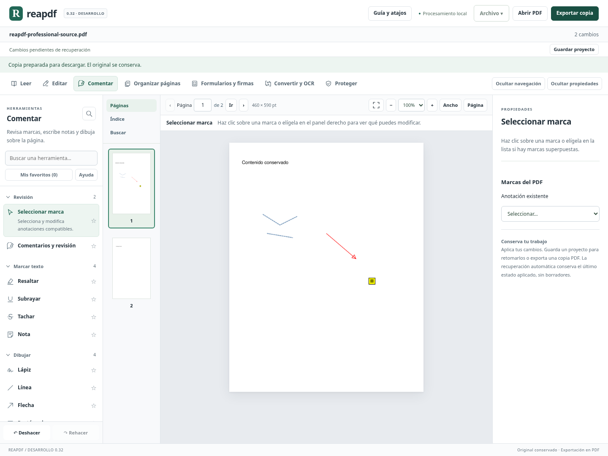
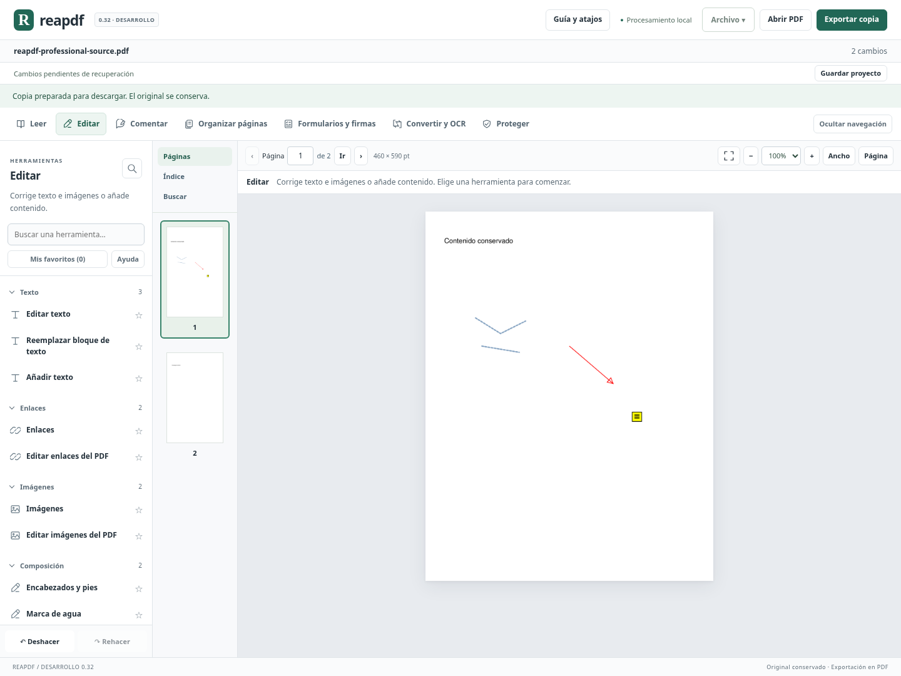

# Interfaz y movimiento de anotaciones — versión 0.32

## Distribución por tareas

Se mantienen siete áreas de trabajo. Dentro de cada área, las herramientas se presentan en grupos plegables para separar las tareas y reducir las listas continuas:

| Área | Grupos |
|---|---|
| Leer | Consultar · Revisar · Documento |
| Editar | Texto · Enlaces · Imágenes · Composición |
| Comentar | Revisión · Marcar texto · Dibujar · Sellos |
| Organizar páginas | Componer · Ajustar y separar · Índice y numeración |
| Formularios y firmas | Campos y datos · Firmas |
| Convertir y OCR | Reconocer · Exportar · Preparar copias |
| Proteger | Seguridad · Conformidad |

Las 56 herramientas siguen disponibles. La búsqueda y los favoritos recorren todas las áreas aunque un grupo esté plegado. Cada herramienta tiene un icono discreto, nombre y explicación al pasar el puntero; las descripciones completas aparecen para la herramienta activa y en los resultados de búsqueda. **Ayuda**, junto a los favoritos, permite mostrar todas las descripciones y conserva esa preferencia en este navegador. Los favoritos mantienen su almacenamiento anterior. Los grupos se abren inicialmente; no se guardan como preferencia persistente.

La navegación por teclado mantiene las flechas y las teclas Inicio/Fin en las áreas, el control nativo de los grupos plegables, Ctrl+K para buscar herramientas y los atajos del documento. Los cambios pendientes siguen bloqueando la navegación que pudiera perderlos. Las acciones no disponibles conservan su sitio y el motivo de su restricción.

## Sistema visual

Se unifican las superficies en blanco y gris claro, con texto pizarra y un solo acento verde profundo para las acciones principales y la selección. Los bordes, radios, espaciado, tipografía y estados de foco se definen de forma común en `web/src/professional.css`; se conserva la compatibilidad de los componentes existentes.

- Barra superior centrada en Archivo, abrir y exportar. Crear PDF desde imágenes está en el inicio y, con un PDF abierto, dentro de Archivo.
- Controles de página y zoom más compactos. «Ancho», «Página» y el icono de lectura ampliada mantienen sus nombres accesibles y sus explicaciones.
- Panel de herramientas agrupado, navegador del documento y propiedades contextuales diferenciados. Las propiedades pueden plegarse sin perder sus valores.
- Campos y botones con tamaños, márgenes y bordes coherentes; foco visible y selección que también se distingue en modo de colores forzados.
- Títulos y cierre de los asistentes fijos durante el desplazamiento, separados del contenido y de las acciones finales.
- Adaptación comprobada a escritorio y anchos menores; en pantalla estrecha las pestañas del documento se disponen en una fila y las áreas se recorren horizontalmente.

Se comprueba el contraste de texto en la acción principal, el encabezado del catálogo, su descripción y los títulos de grupos sobre sus superficies efectivas (mínimo 4,5:1). Esto no sustituye una auditoría completa de accesibilidad ni una revisión manual con lector de pantalla. No se afirma que todos los asistentes tengan un flujo rediseñado por pasos: algunos conservan su organización funcional anterior, ahora con el estilo común.

## Movimiento de trazos y líneas importadas

En **Comentar → Seleccionar marca**, los trazos de lápiz y las líneas/flechas existentes compatibles incorporan controles X/Y. Se pueden mover, aplicar, deshacer y rehacer, exportar y recuperar en el proyecto. El cambio conserva el tamaño; el redimensionado de estas geometrías queda pendiente. Rectángulos y elipses estándar mantienen su redimensionado anterior.

Un movimiento puro traslada los vértices nativos (`InkList` o `L`) y el rectángulo de la anotación. Conserva el flujo de apariencia original, extremos de flecha, segmentos múltiples del trazo, color, grosor, guiones, opacidad, autor e identidad. No convierte la marca en una imagen ni cambia el texto del documento. Para mover y recolorear a la vez, se regenera la apariencia con el motor nativo y se comprueban posición y propiedades.

La conversión de coordenadas contempla las cuatro rotaciones y el recorte de página. Se lee la transformación en el sistema sin giro y se restaura el giro antes de aplicar la geometría; evita el desplazamiento incorrecto por el origen del recorte.

Se rechazan:

- Firmas, permisos insuficientes, anotaciones bloqueadas, conversaciones, agrupaciones o capas protegidas por las reglas existentes.
- Comportamientos especiales de giro/zoom, mediciones, intenciones especiales, efectos de borde, acciones o geometría `Path` no compatible.
- Vértices no válidos, más de 10 000 puntos, cambios de tamaño o posiciones fuera de la página.

Cuando la geometría impide mover una marca que todavía admite otras propiedades, el panel muestra el motivo. No se declara fidelidad universal para apariencias especiales de cualquier fabricante. Movimiento de resaltados importados, redimensionado de trazos/líneas y manipulación directa por tiradores de estas marcas quedan pendientes.

## Validación

Las pruebas del motor contrastan vértices, apariencia nativa, píxeles, estilos, extremos de flecha, identidad, texto y páginas ajenas; cubren cuatro giros, recortes, cambios combinados y rechazos. La prueba del catálogo exige que cada herramienta pertenezca exactamente a una sección de su área, evitando funciones que queden inaccesibles al añadir nuevas entradas.

Chromium verifica plegado por ratón/teclado, ayuda persistente, búsqueda y favoritos, contraste de texto representativo, borradores protegidos, títulos fijos, adaptación a 600/900/1100/1440 px, movimiento de lápiz/flecha con historial y el PDF exportado. Se conservan los recorridos anteriores; el cierre completo se registra en [AVANCE.md](AVANCE.md). La ejecución del programa en Windows y los lectores comerciales siguen pendientes. No se genera otro portable.

Validación del cierre 0.32: **1548 pruebas Python y 91 JavaScript aprobadas (1639 en total)**, compilación de producción y recorrido completo de Chromium aprobados en Linux. Las 46 pruebas nuevas del motor cubren traslado de Ink/Line con cuatro giros y recortes, vértices/apariencias nativas/píxeles y propiedades conservados, cambios combinados de color y geometría, permisos, firmas, propiedades especiales y tamaños/posiciones inválidos. La prueba adicional del catálogo exige que las 56 herramientas estén distribuidas exactamente una vez en sus secciones. Chromium comprueba secciones plegables por teclado/ratón, ayuda persistente, contraste representativo de al menos 4,5:1, borradores, búsqueda/favoritos, títulos fijos, movimiento de lápiz/flecha con historial/exportación/recuperación y anchos de 600/900/1100/1440 px, además de los recorridos anteriores. Se inspeccionaron capturas de la interfaz. Windows y lectores comerciales siguen pendientes. No se generó otro portable; el paquete 0.20 conserva su huella anterior.
