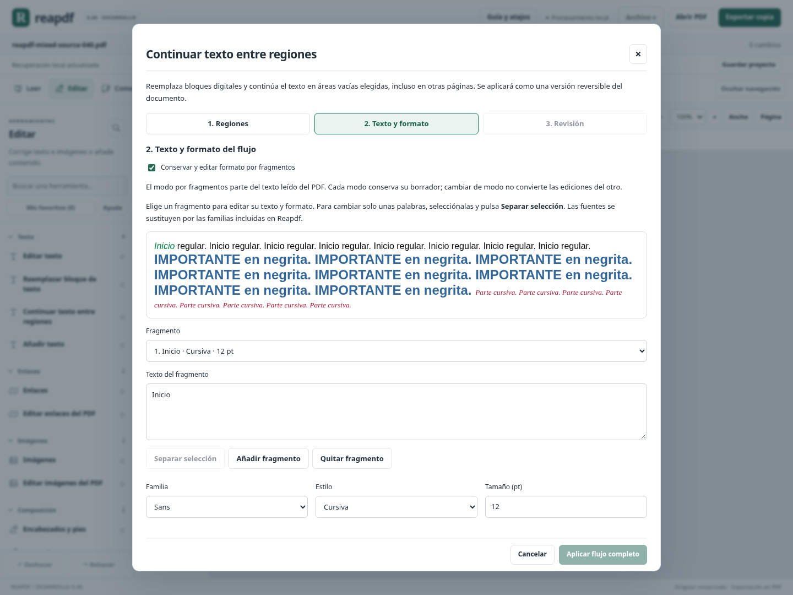
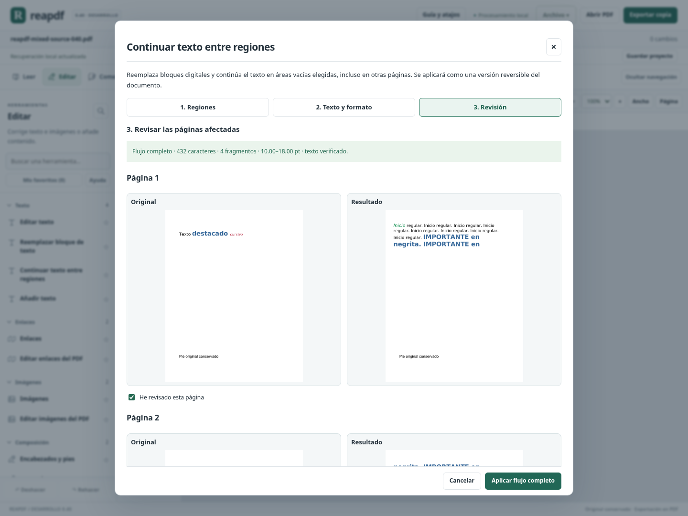

# Reflujo con formato mixto — versión 0.40

Nota de seguimiento: el siguiente hito PAGE/NUMPAGES complejos recomendado al final de esta guía se implementó en [0.41](WORD_CAMPOS_TABLAS_041.md).

Este bloque implementa el pendiente de conservar y editar negrita/cursiva, tamaños y colores al continuar texto entre regiones de páginas existentes. El flujo anterior usaba un formato común para todo el texto. Ahora se puede elegir entre ese modo y **formato por fragmentos**.

## Alcance cerrado y criterios de aceptación

| Criterio de este bloque | Resultado | Evidencia |
|---|---|---|
| Leer texto y estilos compatibles de los bloques originales | Implementado y verificado | Inspección de fragmentos; fuentes, tamaños, colores y estilos; identificación de Monoespaciada aunque sus indicadores PDF sean ambiguos. |
| Editar texto y formato por fragmento, incluida una selección parcial | Implementado y verificado | Editor con separación de selección, añadir/quitar fragmentos, familia, estilo, tamaño y color; recorrido Chromium. |
| Distribuir el conjunto entre regiones/páginas sin uniformar estilos | Implementado y verificado | Negrita/cursiva combinadas, Sans/Serif/Monoespaciada, colores, cuatro alineaciones, giros y recortes; texto PDF nativo. |
| Evitar pérdida de contenido y desbordamientos | Implementado y verificado | Plan completo antes de modificar, ajuste proporcional opcional y comprobación del texto y sus límites en el PDF generado. |
| Revisar y conservar el resultado aplicado | Implementado y verificado | Comparación de todas las páginas, invalidación de revisiones al editar, exportación, proyecto, deshacer/rehacer y recuperación. |

**Resultado: 5 de 5 criterios de este bloque verificados en su alcance compatible.** Esto no significa reflujo universal de PDF ni un porcentaje de equivalencia con Acrobat. El estado de otras capacidades se separa en [ESTADO_FUNCIONAL.md](ESTADO_FUNCIONAL.md).

## Cómo usarlo

1. Abrir un PDF con texto digital y entrar en **Editar → Continuar texto entre regiones**.
2. Elegir las regiones en orden. Marcar las que reemplazan texto original; las continuaciones deben estar vacías. Se puede detectar un bloque y seleccionar su caja.
3. Pulsar **Leer regiones y reunir texto**. El motor reúne también sus fragmentos y formatos compatibles.
4. En **Texto y formato**, activar **Conservar y editar formato por fragmentos**.
5. Elegir un fragmento y modificar texto, familia, negrita/cursiva, tamaño o color. Para cambiar unas palabras, seleccionarlas en el texto del fragmento y pulsar **Separar selección**; el fragmento separado conserva el formato inicial hasta que se cambie.
6. Ajustar alineación e interlineado. Si hace falta, activar la reducción proporcional y definir su tamaño mínimo.
7. Pulsar **Comparar todas las páginas del flujo**. Revisar cada original/resultado y marcar cada página antes de aplicar el flujo completo.
8. Exportar una copia PDF o guardar un proyecto. Deshacer recupera la versión anterior completa.

El modo común conserva su borrador por separado del modo por fragmentos. Activar el modo mixto parte del texto leído del PDF; no asigna automáticamente estilos a una reescritura hecha en el otro modo. Reunir las regiones de nuevo vuelve a cargar su contenido original aplicado.

## Qué conserva y qué sustituye

Se conservan **negrita, cursiva, combinación de ambas, tamaño y color RGB compatibles** de cada fragmento. Al cortar una palabra entre fragmentos, los saltos de línea consideran su ancho completo, sin forzar un salto por el cambio de estilo. La distribución usa las métricas de las fuentes y el mayor ascenso/descenso de cada línea para acomodar tamaños diferentes.

La **fuente exacta original se sustituye** por una de las familias incluidas en Reapdf: Sans, Serif o Monoespaciada, con sus variantes. El motor identifica la familia compatible mediante los indicadores y nombres de fuente disponibles; no garantiza identidad de diseño, espaciado tipográfico o perfiles de color originales. El editor muestra una aproximación del texto; la comparación PDF es la revisión definitiva.

No conserva subrayados/tachados dibujados como gráficos, superíndices/subíndices, espaciado especial de caracteres, texto vertical o inclinado, transparencias, enlaces atravesados por la región ni etiquetas semánticas. No modifica el resto del contenido para crear espacio ni añade páginas automáticamente.

## Ajuste proporcional y seguridad del contenido

Si todo el texto cabe, los tamaños declarados permanecen iguales. Si no cabe y se activa el ajuste, todos se reducen por un mismo factor: una combinación de 24 y 12 pt mantiene su relación 2:1. El menor tamaño resultante no baja del mínimo elegido ni de 6 pt. El informe muestra el intervalo final y si hubo reducción.

Si no cabe completo, se rechaza la operación. El plan se completa antes de retirar el texto original. Las regiones que cortan fragmentos, se solapan o cruzan contenido incompatible también se rechazan.

Después de escribir y guardar el PDF temporal, se vuelve a leer el texto de las regiones y se comparan sus caracteres en orden, normalizados en Unicode y sin espacios/saltos de distribución. Se comprueba también que los fragmentos extraídos permanezcan dentro de sus regiones. Si la comprobación falla, no se entrega ni almacena una versión parcial. Esta verificación no certifica identidad visual ni igualdad de todos los espacios originales.

Los fragmentos de colores distintos se escriben en orden de lectura; no se agrupan por color en capas de contenido que alterarían ese orden. Se incrustan y subconjuntan las fuentes. El resultado sigue siendo texto PDF seleccionable, sin imágenes de las páginas ni superposiciones de página completas.

## Límites explícitos

- Hasta **8 regiones**, **12000 caracteres** y **200 fragmentos** por flujo.
- Tamaños entre **6 y 72 pt**; interlineado entre 1 y 2,5; alineación izquierda, centro, derecha o justificada.
- Texto digital directo, sin escritura de derecha a izquierda ni caracteres que las fuentes incluidas no puedan representar.
- Regiones en coordenadas de la página enderezada; se conservan giro y recorte al guardar.
- Continúan protegidos documentos firmados, permisos insuficientes, capas, etiquetas semánticas, Form XObjects y regiones con imágenes, campos, anotaciones, gráficos o enlaces incompatibles.
- Si el original contiene tamaños o caracteres no compatibles, la inspección informa por qué el modo mixto no está disponible; el modo común conserva su funcionamiento anterior.

El proyecto guarda la nueva versión PDF con sus estilos ya aplicados. No añade un modelo de documento Word ni un editor enriquecido universal. Para editar después el texto distribuido, se deben seleccionar como reemplazo las regiones que ahora lo contienen; una región con texto existente ya no es una continuación vacía.

## Validación

Cierre 0.40: **1993 pruebas Python y 105 JavaScript (2098 en total)**, compilación de producción y recorrido completo de Chromium aprobados en Linux. Son **34 pruebas Python nuevas**.

Las pruebas específicas cubren lectura de estilos, cuatro giros con/sin recorte, colores, tamaños, distintas familias, palabras que cruzan cambios de formato, cuatro alineaciones, líneas vacías, ajuste proporcional y mínimo, desbordamientos, fragmentos inválidos, caracteres no compatibles, inspección posterior de Monoespaciada, API y rechazo de resultados con texto omitido. Se verifica la conservación visual de una página ajena a la edición; Poppler comprueba texto cuando está disponible.

Chromium edita fragmentos leídos del PDF, separa una selección, cambia cursiva/tamaño/color, revisa todas las páginas, invalida la comparación al cambiar una propiedad, comprueba estilos del PDF descargado y verifica proyecto, historial, recuperación y el editor a 600 px. Se mantiene el recorrido previo de formato común y las demás herramientas.

Evidencia ligada a código, compilación y registros: [validation/0.40/receipt.json](validation/0.40/receipt.json) y [CIERRE_040.json](CIERRE_040.json). Sigue pendiente la ejecución del programa en Windows; no se genera otro portable.

## Siguiente hito concreto

El reflujo mixto compatible entre regiones **deja de ser un pendiente genérico**. Permanecen como ampliaciones distintas las fuentes exactas y la estructura semántica, que no forman parte del bloque cerrado aquí.

El siguiente hito recomendado es **interpretar campos Word PAGE/NUMPAGES complejos**, cuyas instrucciones están repartidas en varios fragmentos, conservando variantes de encabezados/pies y verificando los números en documentos generados por otra herramienta. Secciones Word con diseño propio y validación Windows siguen abiertas en la matriz; no se anuncian como trabajos realizados.
