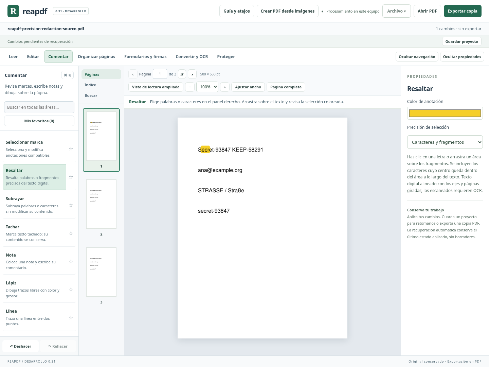
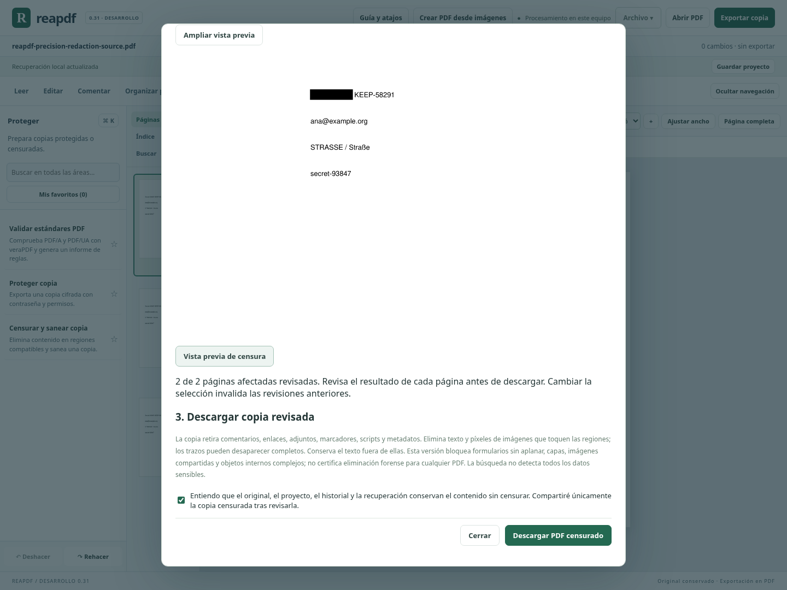

# Selección precisa y censura por búsqueda — 0.31

## Marcar fragmentos del texto

En **Comentar → Resaltar / Subrayar / Tachar**, el panel de propiedades permite elegir **Palabras completas** o **Caracteres y fragmentos**. Las palabras siguen siendo la opción inicial. El modo preciso permite pulsar una letra o arrastrar sobre parte de una palabra. Durante el arrastre aparece una selección coloreada antes de aplicar la marca.

Se toman los centros de los caracteres a lo largo de la dirección del texto; en la dirección perpendicular basta con que el área atraviese la línea. Esto permite un gesto horizontal o vertical sin encerrar toda la altura de la letra. Los caracteres consecutivos del mismo estilo se agrupan para crear una anotación nativa con menos vértices. No se unen espacios, estilos o líneas distintos. El arrastre inverso funciona igual.

Se conservan texto, giros de página y coordenadas de los caracteres. Hay deshacer/rehacer y persistencia en el proyecto mediante las operaciones de anotación existentes. Límites: texto digital alineado con los ejes, 100 000 caracteres de selección precisa por página y 500 fragmentos por marca. Si se llega al límite de caracteres, aparece una advertencia. Una ligadura que el PDF codifica como un único glifo puede conservarse como unidad. El texto oblicuo, el reflujo automático de las marcas y la interpretación del orden de columnas siguen pendientes. Las marcas visuales **no retiran información**.

## Preparar una copia censurada

En **Proteger → Censurar y sanear copia** hay dos métodos, con pasos separados para preparar, revisar y descargar:

- **Regiones manuales**: dibujar o introducir medidas, añadir regiones en distintas páginas, verlas y eliminarlas individualmente. Hasta 100 regiones en 20 páginas.
- **Buscar términos y correos**: introducir hasta 20 términos literales, uno por línea, y un rango de hasta 20 páginas, por ejemplo `1-3, 5`. Se puede distinguir mayúsculas y añadir sugerencias de correos electrónicos de formato común. La búsqueda tiene un máximo de 500 coincidencias y 500 000 caracteres; excederlo rechaza la búsqueda completa y pide reducirla.

La búsqueda usa el documento con las ediciones aplicadas. No interpreta expresiones regulares, no une términos a través de saltos de línea ni corrige automáticamente guiones, espaciados o errores del OCR. La comparación sin mayúsculas usa `casefold` de Unicode conservando la correspondencia con las posiciones originales, incluida la expansión `ß → ss`. Los términos repetidos en la misma región no duplican la coincidencia. Las páginas sin texto digital y las páginas con texto oblicuo omitido se indican en el resultado.

**Ninguna coincidencia se elige automáticamente.** Se puede seleccionar hasta 100, ver su página y revisar qué se retirará. Las sugerencias de correos pueden omitir direcciones o producir falsos positivos: no son un detector general de información confidencial. Texto en imágenes necesita OCR o regiones manuales. El resto de las imágenes también debe revisarse visualmente.

Cada inspección tiene una huella vinculada al original, las operaciones aplicadas y la consulta exacta. El servidor vuelve a calcular las coincidencias y valida sus identificadores antes de cada vista previa o descarga. Rechaza inspecciones antiguas y selecciones ajenas o repetidas. No guarda consultas ni resultados en el proyecto o en la recuperación; esos datos son temporales del asistente.

## Revisar todas las páginas afectadas

El selector de páginas identifica las pendientes y revisadas. **Vista previa de censura** produce el resultado del motor para la página elegida. Hay que generar la vista de cada página afectada antes de descargar. Modificar regiones, método, consulta o selección invalida las revisiones anteriores, incluso si después se vuelve a la selección previa. El control de revisión pertenece a la interfaz; el motor también mantiene sus validaciones de regiones y estructuras en cada solicitud.

La descarga exige confirmar el alcance: el original, el proyecto, el historial y la recuperación mantienen la información sin censurar. La copia descargada es un resultado separado; no sustituye el documento abierto ni agrega una operación reversible que pudiera confundirse con una censura definitiva.

## Límites del motor conservados

Se eliminan texto y píxeles de las imágenes que tocan las regiones. Los trazos que las toquen pueden desaparecer completos. La copia también retira comentarios, enlaces, adjuntos, marcadores, scripts y metadatos. Se mantienen los rechazos de firmas, permisos insuficientes, formularios sin aplanar, capas, imágenes compartidas, Form XObjects, contenido marcado, imágenes en línea, patrones y estructuras que todavía no se han auditado. Buscar coincidencias puede funcionar en una página cuya censura después se rechace: encontrar texto no demuestra que su estructura sea segura para retirarlo.

No se certifica eliminación forense para cualquier PDF ni que se hayan identificado todos los datos sensibles. Se debe revisar el PDF descargado antes de compartirlo. La prueba independiente de extracción de texto es evidencia para los casos probados, no una garantía universal.

## Evidencia

Las pruebas del motor cubren selección parcial en tres tipos de anotación y cuatro giros; censura selectiva multipágina con recortes y cuatro giros; Unicode; conservación de contenido no elegido y de una página intacta; búsqueda sobre ediciones; límites, permisos, firmas, inspecciones antiguas y selección manipulada. La extracción independiente con Poppler verifica la ausencia del texto elegido en las páginas de salida.

El recorrido Chromium prueba la selección visible de un fragmento, los vértices nativos del PDF descargado, el historial, búsquedas sin selección automática, censura parcial de coincidencias, revisión obligatoria de todas las páginas, invalidación al cambiar la selección, descarga y conservación del original. También prepara regiones manuales en dos páginas y elimina una individualmente. La evidencia completa del cierre se registra en [AVANCE.md](AVANCE.md). Windows y lectores comerciales siguen pendientes.

Validación del cierre 0.31: **1502 pruebas Python y 90 JavaScript aprobadas (1592 en total)**, compilación de producción y recorrido completo de Chromium aprobados en Linux. Se añaden 51 pruebas Python y 5 JavaScript para selección parcial, vértices de tres tipos de marca en cuatro giros, búsqueda/censura selectiva con giros y recortes, Unicode, conservación de contenido no seleccionado, permisos, límites y rechazo de inspecciones/identificadores inválidos. Chromium verifica el arrastre visible, anotaciones nativas descargadas, historial, búsquedas sin selección automática, revisión de todas las páginas, invalidación de revisiones, censura manual multipágina y regiones eliminables. Poppler comprueba de forma independiente la extracción del PDF censurado. Se revisaron capturas de la interfaz. Windows, lectores comerciales y censura universal siguen pendientes. El portable 0.20 conserva su huella y no se generó otro paquete.

