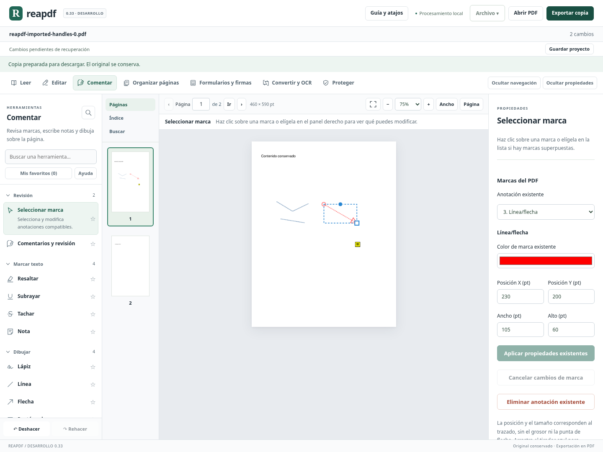

# Transformación directa de trazos importados — 0.33

## Qué añade este avance

La versión 0.32 permitía **trasladar por coordenadas** trazos de lápiz y líneas/flechas existentes. La 0.33 añade dos capacidades concretas: **cambiar su tamaño** y **mover/redimensionar directamente sobre la página mediante tiradores**. No es otro cambio de colores o agrupación del catálogo.

En **Comentar → Seleccionar marca**, elige un trazo o una línea/flecha existente:

1. El marco azul sigue los vértices del trazado. El círculo superior permite moverlo; el cuadrado de la esquina cambia su tamaño.
2. Arrastra y revisa la guía azul del trazado propuesto. Al soltar, el motor comprueba y aplica el cambio como una entrada de historial.
3. Escape, cancelación del puntero o pérdida de captura descartan el gesto. No añaden un cambio al documento.
4. Con el foco en un tirador, las flechas ajustan 1 punto PDF; Mayús+flecha, 10. En el tirador de tamaño cambian ancho/alto, y en el de movimiento cambian X/Y.
5. También puedes introducir X/Y/ancho/alto en el panel y pulsar **Aplicar propiedades existentes**. Mientras haya valores sin aplicar, los tiradores quedan ocultos para no mezclar dos cambios pendientes.

Deshacer/rehacer conserva la selección del trazado si sigue perteneciendo a la misma versión del documento. Los cambios se guardan en el proyecto y la recuperación. Abrir un proyecto anterior con movimientos por rectángulo exterior sigue siendo compatible; al editar su geometría se convierte al modelo del trazado sin duplicar la transformación.

## Qué significan las medidas

La caja corresponde a los extremos de los vértices, **sin incluir el grosor, los márgenes de apariencia ni la punta de flecha**. Es una referencia estable para escalar sin confundir esos adornos con el tamaño del trazado. El PDF final conserva su borde y extremos nativos, que pueden sobresalir de esa guía.

Una línea exactamente horizontal o vertical mantiene su dimensión cero. Su campo correspondiente queda desactivado y el tirador solo cambia la longitud en la dimensión existente. Cambiar la dirección de una línea mediante dos tiradores de extremos es una capacidad distinta, pendiente de implementar.

El mínimo para una dimensión que cambia es 1 punto PDF. Los valores sin modificar más pequeños se pueden trasladar. El motor tolera diferencias de hasta 0,001 pt para distinguir un cambio de tamaño de las pequeñas variaciones de coordenadas; un traslado mantiene las distancias internas originales. El borde real y las puntas deben permanecer dentro de la página, no solo la guía de vértices.

La guía durante el gesto muestra los segmentos del trazo y una línea central para las flechas; la vista final del PDF incluye la apariencia completa. Para páginas que superan el presupuesto de 100 000 puntos de guías, algunas marcas muestran solo una guía de límites. El motor mantiene su límite de 10 000 vértices por marca.

## Conservación y compatibilidad

- Un movimiento puro conserva el flujo de apariencia original y traslada sus vértices y rectángulo exterior.
- Un cambio de tamaño escala los vértices; el motor regenera la anotación conservando tipo, grosor, guiones, color, opacidad, autor, identidad y extremos de flecha. No aplana la página ni convierte la marca en una imagen.
- Antes de permitir esa regeneración, se copia temporalmente la página y se comprueba que regenerar la marca sin cambiar su geometría reproduce exactamente su apariencia visible a escala 2. Si cambia, se rechaza el redimensionado para no retirar símbolos o elementos personalizados. Moverla sigue estando disponible si cumple las restricciones anteriores.
- La comprobación de apariencia admite hasta 4 millones de píxeles por marca; las marcas mayores conservan su tamaño. La copia temporal no sustituye el original ni se incorpora al proyecto.
- Los casos de firma, permisos insuficientes, bloqueo, hilos/grupos, capas, medidas, acciones y propiedades especiales conservan las protecciones anteriores. No se afirma compatibilidad universal con apariencias de todos los fabricantes.

Los giros de 0/90/180/270° y el recorte de página se mantienen. Los cambios se calculan respecto a los vértices originales; aplicar varias ediciones sucesivas de color, posición o tamaño no vuelve a escalar una geometría ya escalada.

## Verificación y límites pendientes

Las pruebas del motor contrastan coordenadas nativas, tamaño, segmentos múltiples, estilos, identidad, puntas, texto y páginas ajenas, con cuatro giros y recortes. Incluyen dimensiones cero, límites de página, propiedades especiales, proyectos, combinación con color y rechazo de apariencias personalizadas. Poppler verifica independientemente la representación de una flecha redimensionada y el texto conservado.

Chromium comprueba arrastre al 75 % de zoom, guía, cancelación, teclado, cambios numéricos, bloqueo de borradores, historial con selección conservada, exportación, proyecto/recuperación y líneas horizontales. Se conserva la regresión del editor anterior; el cierre completo figura en [AVANCE.md](AVANCE.md).

Pendientes distintos de este avance: editar individualmente los dos extremos de una línea para cambiar su dirección, seleccionar y alinear varias marcas, transformar resaltados importados y verificar documentos representativos en Windows y lectores comerciales.

Validación del cierre 0.33: **1596 pruebas Python y 94 JavaScript aprobadas (1690 en total)**, compilación de producción y recorrido completo de Chromium aprobados en Linux. Se añaden 48 pruebas Python y 3 JavaScript: escala de vértices con cuatro giros/recortes, estilos y puntas conservados, dimensiones cero y líneas casi horizontales, movimiento con apariencia intacta, combinación con color, límites, apariencia personalizada rechazada, API, proyectos y compatibilidad de geometría anterior. Poppler comprueba de forma independiente la representación de una flecha redimensionada y el texto conservado. Chromium verifica los tiradores al 75 % de zoom, guía, Escape, teclado, borradores, historial con selección conservada, exportación, proyectos/recuperación y líneas horizontales, junto a los flujos anteriores. Después del ajuste final para evitar un marco de selección duplicado, se repitió y aprobó el recorrido específico de los tiradores en los cuatro giros. Se inspeccionó su captura. Windows, lectores comerciales, extremos individuales y selección múltiple siguen pendientes. No se generó otro portable; el paquete 0.20 conserva su huella anterior.
