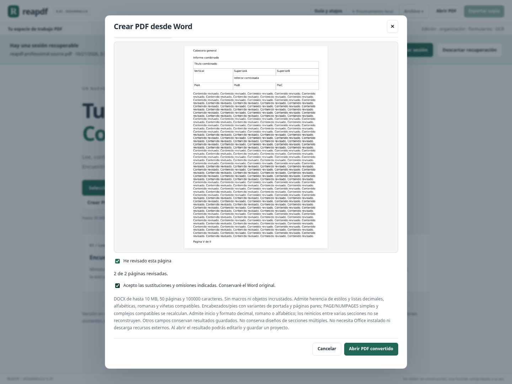
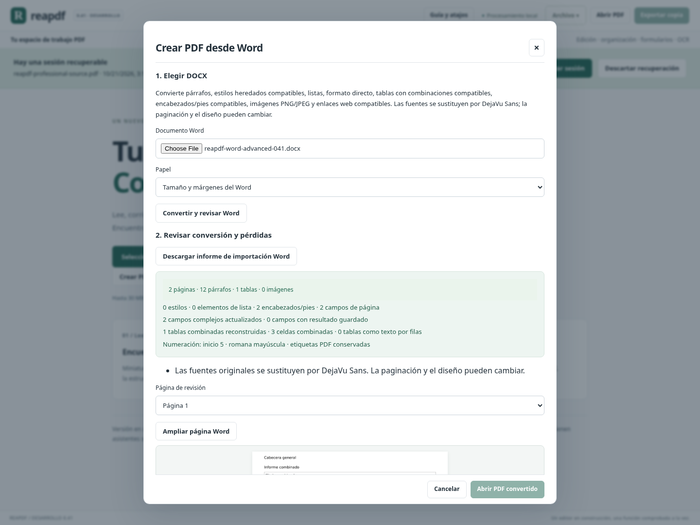

> Actualización: las secciones con salto a página siguiente y diseño independiente se incorporan en [0.42](WORD_SECCIONES_042.md). El cierre 0.41 se conserva como registro histórico.

# Avance 0.41: campos complejos, numeración y tablas combinadas de Word

Este bloque implementa varios trabajos del importador Word. PAGE/NUMPAGES complejos dejan de ser un pendiente genérico: ahora se interpretan sus límites, instrucciones y resultados compatibles. Se añaden numeración configurable, etiquetas PDF y reconstrucción de combinaciones rectangulares de celdas.

## Cinco entregables y evidencia de cierre

| Entregable | Resultado verificado |
|---|---|
| PAGE/NUMPAGES complejos en encabezados/pies | Instrucciones repartidas entre fragmentos, límites dentro de un mismo fragmento, estilos y resultados guardados; rechazo de campos incompletos. |
| Inicio y formato de numeración | Decimal, romanos y letras; formato de sección y modificadores compatibles del campo; distinción de MERGEFORMAT/CHARFORMAT. |
| Etiquetas de navegación PDF | Se conserva la numeración de sección compatible en etiquetas nativas; navegación, exportación, proyecto y recuperación comprobados. |
| Tablas con celdas combinadas | Combinaciones horizontales y verticales rectangulares, incluyendo marcadores horizontales antiguos; posición y contenido verificados. |
| Revisión e informe de conversión | Resumen de campos actualizados/guardados, tablas reconstruidas/convertidas a texto y numeración; revisión multipágina y rechazo sin sustituir el documento abierto. |

**5/5 entregables verificados dentro de los límites siguientes.** No equivalen a completar toda la conversión Office ni se transforman en un porcentaje comercial del programa. Estado general: [ESTADO_FUNCIONAL.md](ESTADO_FUNCIONAL.md).

## 1. Campos complejos sin ejecutar instrucciones Office

Word puede guardar PAGE/NUMPAGES como campos simples o como una secuencia de inicio, instrucciones, separador, resultado y cierre repartida entre varios fragmentos. El importador ahora reconoce esta segunda forma en encabezados y pies compatibles. También mantiene el texto que rodea un campo cuyos límites están dentro del mismo fragmento.

Solo se actualizan **PAGE** y **NUMPAGES** con sus modificadores admitidos. No se ejecuta un motor de instrucciones Office. Otros comandos —por ejemplo DATE, INCLUDETEXT o IF— conservan el resultado guardado disponible, con aviso. Las direcciones escritas en una instrucción no se consultan ni descargan.

Los campos anidados que forman parte del resultado de un campo no compatible se conservan como resultado guardado; no se recalcula un PAGE interior que pudiera alterar el significado del resultado exterior. Una instrucción que depende de otro campo tampoco se simplifica artificialmente a PAGE.

Un inicio sin cierre, separadores sin inicio o repetidos, instrucciones fuera de límites compatibles y otros errores de estructura se rechazan. No se crea una conversión parcial ni se reemplaza el documento abierto.

**Alcance:** campos delimitados dentro de un párrafo/contenedor compatible del encabezado o pie. Campos repartidos entre párrafos o estructuras más complejas requieren trabajo adicional. Los campos del cuerpo continúan utilizando sus resultados guardados; no se actualizan con esta función.

## 2. Numeración desde un valor y con formatos compatibles

Se interpreta la numeración de la sección importada:

- Inicio entre **1 y 9999**.
- Decimal, romano mayúsculo/minúsculo y alfabético mayúsculo/minúsculo.
- PAGE utiliza el inicio y formato de esa sección, salvo que el propio campo indique un formato compatible.
- NUMPAGES representa la cantidad real de páginas del PDF, sin sumar el inicio elegido. Su formato predeterminado es decimal; puede tener un modificador explícito.

Se admiten los modificadores numéricos `\* Arabic`, `\* ROMAN`, `\* roman`, `\* ALPHABETIC` y `\* alphabetic`. Un modificador numérico no admitido conserva el resultado guardado y se declara en el informe. No se adivina su intención.

Para campos complejos, `MERGEFORMAT` mantiene el formato compatible de su resultado guardado; `CHARFORMAT` toma el formato compatible del primer carácter de la instrucción. Si no hay un resultado guardado, se conserva el formato de inicio disponible o el heredado del párrafo. Las fuentes siguen sustituyéndose por las incluidas en Reapdf.

Ejemplo: inicio **5**, formato romano mayúsculo y un PDF de dos páginas producen PAGE **V / VI**. Un NUMPAGES con formato romano produce **II** en ambas páginas. La medición previa reserva espacio de forma conservadora y el dibujo vuelve a comprobar que los valores definitivos caben completos.

**No se reconstruyen reinicios internos de varias secciones.** Como en el importador anterior, se usa una sección común para el PDF; si hay varias, se informa de la sustitución. Romanos: 1–3999; letras: 1–18278. Una numeración que excede el alcance admitido se rechaza.

## 3. Etiquetas PDF coherentes con la sección

Cuando se actualizan campos y hay numeración de sección compatible, el PDF recibe etiquetas nativas con ese inicio y formato. Por ejemplo, el selector del lector ofrece **V · pág. 1** y **VI · pág. 2**. Se conservan al descargar PDF, guardar proyecto y recuperar la sesión.

Las etiquetas reflejan el formato de **sección**, no un modificador aislado de un campo. Si un campo fuerza un formato distinto, puede mostrar otro valor de presentación, como en el documento de origen. No se cambian las posiciones físicas de las páginas ni el total.

## 4. Tablas con combinaciones horizontales y verticales

Las tablas compatibles se reconstruyen como tablas nativas del PDF, usando una cuadrícula de columnas y las combinaciones indicadas por Word. Se conservan:

- Combinaciones horizontales `gridSpan`.
- Combinaciones horizontales antiguas con inicio/continuación `hMerge`, incluyendo el texto de cada celda física.
- Combinaciones verticales `vMerge` con inicio y continuaciones vacías compatibles.
- Combinaciones horizontales y verticales rectangulares coherentes entre filas.

Las continuaciones verticales no duplican el contenido del inicio. Se verifican posición de textos, cantidad de celdas combinadas, contenido completo y conservación de gráficos de tabla. Los textos siguen siendo seleccionables y las herramientas de edición de párrafos compatibles pueden modificarlos después de importar. También se admiten estas tablas en encabezados/pies si caben en su espacio limitado.

Si hay cuadrículas contradictorias, continuaciones sin inicio, contenido propio en una continuación vertical o columnas omitidas no admitidas, la tabla pasa a **texto por filas**, con el motivo declarado. Se conserva el texto de cada celda física en lugar de omitirlo para forzar una geometría. Si una tabla combinada reconstruida pierde texto durante el renderizado, se rechaza la conversión.

Se conserva una distribución compatible; no se garantiza la anchura, diseño, bordes o decoración exactos de Word. Las tablas anidadas siguen fuera del alcance y generan aviso.

## 5. Informe y revisión más claros

El asistente separa el resumen de contenido de los resultados de campos, tablas y numeración. El JSON descargable incorpora:

- Campos complejos encontrados, campos de página complejos actualizados y campos con resultado guardado.
- Tablas combinadas reconstruidas, celdas combinadas y tablas convertidas a texto por filas.
- Inicio/formato de numeración y conservación de etiquetas PDF.
- Comprobación de texto y huellas de los bytes Word/PDF, además de los datos anteriores.

Los conteos corresponden a las definiciones importadas, no a cada repetición de un encabezado en todas las páginas. Se mantiene la revisión obligatoria de cada página antes de abrir el resultado. Un error en otra conversión deja intacto el documento que estaba abierto.

## Límites y validación

Continúan los límites anteriores de paquete, XML, texto, imágenes y páginas. Se añaden hasta **500 campos complejos por parte**, **16 niveles de anidación**, **2000 caracteres por instrucción**, **500 campos de página por documento** y **50 columnas lógicas por tabla**. Las estructuras excesivas o incompletas se rechazan; no se permiten entidades, macros ni descargas externas.

Cierre: **2046 pruebas Python y 105 JavaScript, 2151 en total**, compilación y recorrido completo de Chromium en Linux. Son **53 pruebas Python nuevas**. Cubren campos fragmentados/anidados/incompletos, resultados guardados, límites, formatos, inicios, etiquetas y API; estilos MERGEFORMAT/CHARFORMAT; combinaciones de tablas, posición de textos, alternativas sin pérdida y edición posterior. Poppler contrasta el texto cuando está disponible.

Chromium importa un Word con campos complejos y tabla combinada, revisa sus páginas, verifica informe y huella del PDF real, navega por etiquetas romanas y comprueba proyecto/recuperación. Intenta importar un campo incompleto y comprueba que no sustituye el documento abierto. También revisa el asistente a 600 px; se mantiene la regresión previa.

Como comprobación adicional, un DOCX producido por una biblioteca independiente generó cuatro páginas con campos complejos actualizados y combinaciones de tabla conservadas, sin diferencias en la comprobación de texto. No sustituye un corpus de documentos reales ni una comparación visual en Word/LibreOffice.

Evidencia: [validation/0.41/receipt.json](validation/0.41/receipt.json) y [CIERRE_041.json](CIERRE_041.json). La ejecución Windows sigue sin validar. No se genera otro portable.

## Siguiente hito distinto

PAGE/NUMPAGES complejos y combinaciones rectangulares compatibles **quedan implementados**. La siguiente ampliación recomendada es **secciones Word con tamaño, orientación, márgenes y encabezados propios**, con cambios de sección explícitos y numeración por sección. No se presenta ese trabajo como parte de lo cerrado aquí.
