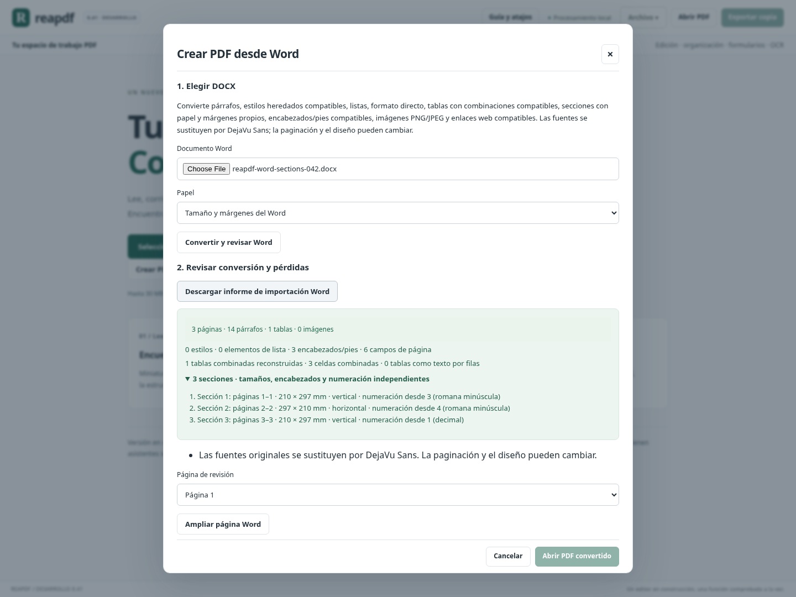
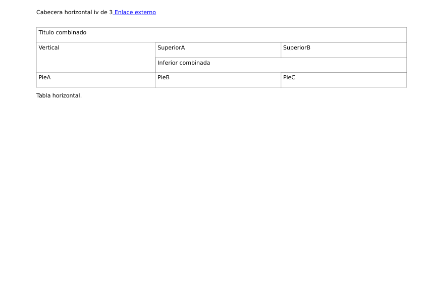

# Secciones Word independientes — 0.42

Este bloque amplía el importador local: una portada vertical, una sección horizontal y un anexo pueden conservar sus dimensiones, márgenes, encabezados y numeración independientes. No vuelve a contar los campos complejos y tablas combinadas cerrados en 0.41.

## Ocho entregables y comprobaciones de cierre

1. Separación del cuerpo por `sectPr`, incluyendo las propiedades del párrafo que termina cada sección y la sección final del documento.
2. Papel, orientación y márgenes propios al elegir «Tamaño y márgenes del Word». A4/Carta aplican la elección a todas las secciones, con márgenes compatibles comunes.
3. Encabezados/pies propios y vinculados a la sección anterior por variante. La portada se determina por sección; la selección de variantes pares sigue la posición física en el PDF.
4. Continuación o reinicio explícito de numeración, cambio de formato y etiquetas nativas PDF por sección, incluso sin campos dinámicos.
5. Paginación previa de todas las secciones: PAGE usa su numeración; NUMPAGES usa el total del documento. Los enlaces de encabezados y cuerpo se conservan en sus páginas.
6. Campo SECTIONPAGES simple/complejo en encabezados/pies, con formatos numéricos compatibles: muestra la cantidad de páginas de la sección actual.
7. Saltos manuales `w:br type="page"` y `pageBreakBefore` compatibles generan páginas reales; los fragmentos antes/después conservan el formato directo. Un salto dentro de un enlace debe separarse antes de importar; los saltos en encabezados/pies se rechazan.
8. Informe JSON y resumen plegable de secciones en la interfaz: páginas físicas, dimensiones, orientación, inicio/formato de numeración; revisión de todas las páginas, PDF exportado, proyecto y recuperación.

## Límites

Se admiten **secciones que comienzan en página siguiente**. Las secciones posteriores continuas, de columna, pares o impares se rechazan con una explicación; no se convierten silenciosamente a otro diseño. Hasta 50 secciones y 50 páginas en total, dentro de los límites previos de texto, imágenes, paquete y campos. La sustitución de fuentes y las omisiones ya declaradas del importador siguen vigentes. No reproduce columnas, cuadros flotantes ni el motor de distribución de Office. Otros comandos de campos conservan resultados guardados; esta entrega no añade un evaluador general de campos ni actualiza índices.

El informe enumera definiciones renderizadas por sección. Un encabezado heredado se registra para cada sección que lo utiliza; sus repeticiones por página están separadas en `header_footer_instances`. Los márgenes informados son los solicitados; la reserva de encabezados/pies puede aumentar el espacio del cuerpo para impedir superposiciones.

## Validación

**Cierre: 2063 pruebas Python + 105 JavaScript = 2168 pruebas aprobadas**, compilación y recorrido completo de Chromium en Linux. Se añadieron 17 casos Python de secciones/saltos. Tras mejorar el caso de prueba con una tabla combinada real y pulir las unidades/nombres de la interfaz, se repitieron esos 17 casos y el recorrido dirigido de secciones sobre la compilación final.

La regresión verifica orientación, márgenes, numeración continua/reiniciada, etiquetas PDF, enlaces, totales globales y por sección, saltos y rechazo de estructuras no admitidas. Chromium comprueba el resumen plegable, la vista horizontal, revisión, navegación por etiquetas, huella exacta de la exportación, proyecto y recuperación; una importación rechazada conserva el documento abierto. Revisa también el diálogo a 600 px.

Un DOCX adicional producido con una biblioteca independiente generó cuatro páginas: vertical, horizontal y dos páginas del anexo; heredó la cabecera correcta y las etiquetas 1/2/1/2, sin diferencias de texto. Esto no sustituye una comparación visual con Word ni un corpus de documentos reales.

Evidencia local de cierre: [CIERRE_042.json](CIERRE_042.json) y [receipt.json](validation/0.42/receipt.json). Las cantidades finales de pruebas quedan en ese recibo. No se genera otro portable ni se da por validado Windows.

## Avance y siguientes trabajos distintos

**Bloque cerrado: 8/8 entregables (100 % de este alcance acotado), con evidencia de regresión.** No es el 100 % del producto ni equivalencia con Acrobat. El anterior ≈90 % global no tiene precisión suficiente para aumentarlo responsablemente.

El siguiente bloque recomendado cambia de área: grupos persistentes de anotaciones, con selección/transformación conjunta, desagrupación y continuidad en proyectos/recuperación. Después: cálculos nativos de formularios con interoperabilidad comprobada y validación del ejecutable propio en Windows. Siguen abiertos los criterios de seguridad, firmas, accesibilidad e interoperabilidad de [release-criteria.json](release-criteria.json).

